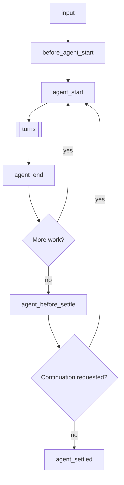
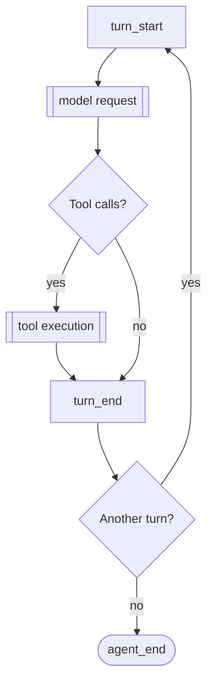
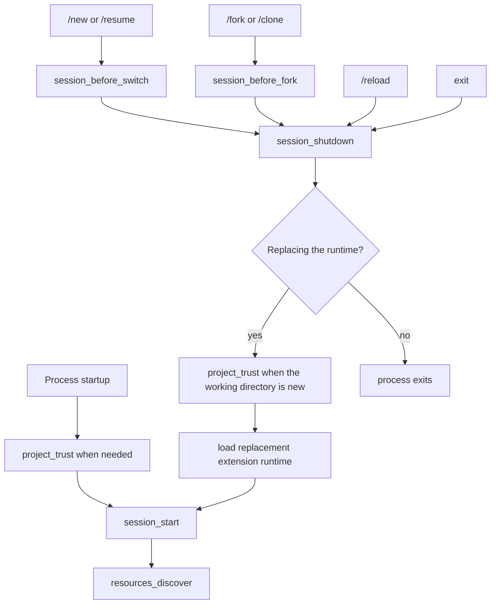

> 这是简体中文译本，译自 `packages/coding-agent/docs/extensions.md`。与英文原文如有出入，以原文为准。

> Pi 可以创建扩展。让它为你的使用场景构建一个。

# 扩展

扩展是扩展 Pi 行为的 TypeScript 模块。它们可以订阅生命周期事件、注册 LLM 可调用的自定义工具、添加命令等。

扩展在 Pi 进程内运行，拥有相同的操作系统权限。它可以检查提示词、工具调用、文件、凭证和会话历史，因此只应从你信任的来源加载扩展。

> **/reload 的放置位置：** 将扩展放入 `~/.pi/agent/extensions/`（全局）或 `.pi/extensions/`（项目本地）以便自动发现。仅在快速测试时使用 `pi -e ./path.ts`。自动发现位置中的扩展可通过 `/reload` 热重载。

**主要能力：**
- **自定义工具** - 通过 `pi.registerTool()` 注册 LLM 可调用的工具
- **事件拦截** - 阻止或修改工具调用、注入上下文、自定义压缩
- **用户交互** - 通过 `ctx.ui`（select、confirm、input、notify）提示用户
- **自定义 UI 组件** - 通过 `ctx.ui.custom()` 提供带键盘输入的完整 TUI 组件，用于复杂交互
- **自定义命令** - 通过 `pi.registerCommand()` 注册类似 `/mycommand` 的命令
- **会话持久化** - 通过 `pi.appendEntry()` 存储可跨重启保留的状态
- **自定义渲染** - 控制工具调用/结果和消息在 TUI 中的显示方式
- **Provider 与 MCP 服务器** - 注册模型 provider、虚拟模型和 MCP 服务器

**示例用例：**
- 权限门禁（在执行 `rm -rf`、`sudo` 等之前确认）
- Git 检查点（每轮 stash，在分支上恢复）
- 路径保护（阻止写入 `.env`、`node_modules/`）
- 自定义压缩（按你的方式总结对话）
- 对话摘要（参见 `summarize.ts` 示例）
- 交互式工具（问题、向导、自定义对话框）
- 有状态工具（待办列表、连接池）
- 外部集成（文件监视器、webhook、CI 触发）
- 等待时的小游戏（参见 `snake.ts` 示例）

可运行的实现见 [examples/extensions/](../../../packages/coding-agent/examples/extensions/)。

## 目录

- [快速开始](#quick-start)
- [扩展位置](#extension-locations)
- [可用的导入](#available-imports)
- [编写扩展](#writing-an-extension)
  - [扩展风格](#extension-styles)
- [事件](#events)
  - [生命周期概览](#lifecycle-overview)
  - [处理器组合](#handler-composition)
  - [启动事件](#startup-events)
  - [资源事件](#resource-events)
  - [会话事件](#session-events)
  - [Agent 事件](#agent-events)
  - [模型事件](#model-events)
  - [工具事件](#tool-events)
  - [用户 Bash 事件](#user-bash-events)
  - [输入事件](#input-events)
- [ExtensionContext](#extensioncontext)
- [ExtensionCommandContext](#extensioncommandcontext)
- [ExtensionAPI 方法](#extensionapi-methods)
- [状态管理](#state-management)
- [自定义工具](#custom-tools)
  - [工具暴露](#tool-exposure)
  - [调用其他工具](#calling-other-tools)
  - [动态工具加载](#dynamic-tool-loading)
- [MCP 服务器](#mcp-servers)
- [自定义 UI](#custom-ui)
- [错误处理](#error-handling)
- [模式行为](#mode-behavior)
- [示例参考](#examples-reference)

<a id="create-an-extension"></a>

<a id="quick-start"></a>

## 快速开始

创建 `~/.pi/agent/extensions/my-extension.ts`：

```typescript
import { type ExtensionAPI, isToolCallEventType } from "@earendil-works/pi-coding-agent";
import { Type } from "typebox";

export default function (pi: ExtensionAPI) {
  // React to events
  pi.on("session_start", async (_event, ctx) => {
    ctx.ui.notify("Extension loaded!", "info");
  });

  pi.on("tool_call", async (event, ctx) => {
    if (isToolCallEventType("bash", event) && event.input.command.includes("rm -rf")) {
      const ok = await ctx.ui.confirm("Dangerous!", "Allow rm -rf?");
      if (!ok) return { block: true, reason: "Blocked by user" };
    }
  });

  // Register a custom tool
  pi.registerTool({
    name: "greet",
    label: "Greet",
    description: "Greet someone by name",
    parameters: Type.Object({
      name: Type.String({ description: "Name to greet" }),
    }),
    async execute(toolCallId, params, signal, onUpdate, ctx) {
      return {
        content: [{ type: "text", text: `Hello, ${params.name}!` }],
        details: {},
      };
    },
  });

  // Register a command
  pi.registerCommand("hello", {
    description: "Say hello",
    handler: async (args, ctx) => {
      ctx.ui.notify(`Hello ${args || "world"}!`, "info");
    },
  });
}
```

用 `--extension`（或 `-e`）标志测试：

```bash
pi -e ./my-extension.ts
```

<a id="choose-where-it-loads"></a>

<a id="extension-locations"></a>

## 扩展位置

> **安全：** 扩展以你的完整系统权限运行，可以执行任意代码。只应安装来自你信任来源的扩展。

扩展会从受信任的位置自动发现。项目本地的 `.pi/extensions` 条目仅在项目被信任后加载。

| 位置 | 范围 |
|----------|-------|
| `~/.pi/agent/extensions/*.ts` 或 `*.js` | 全局（所有项目） |
| `~/.pi/agent/extensions/*/index.ts` 或 `index.js` | 全局（子目录） |
| `~/.pi/agent/extensions/*/package.json` 带 `pi.extensions` 字段 | 全局（带清单的子目录） |
| `.pi/extensions/...` | 项目本地，相同布局 |

发现只深入一层。较大的包在 `package.json` 清单中声明其入口点。

通过 `settings.json` 添加额外路径：

```json
{
  "packages": [
    "npm:@foo/bar@1.0.0",
    "git:github.com/user/repo@v1"
  ],
  "extensions": [
    "/path/to/local/extension.ts",
    "/path/to/local/extension/dir"
  ]
}
```

设置也接受 `builtin:<name>` 形式的内置扩展条目；参见 [设置](settings.md#resources)。要通过 npm 或 git 以 Pi 包的形式共享扩展，参见 [packages.md](packages.md)。

<a id="available-imports"></a>

## 可用的导入

| 包 | 用途 |
|---------|---------|
| `@earendil-works/pi-coding-agent` | 扩展类型（`ExtensionAPI`、`ExtensionContext`、事件）和辅助函数 |
| `@earendil-works/pi-agent-core` | agent 消息与工具类型 |
| `typebox`、`typebox/compile`、`typebox/value` | 工具参数的 schema 定义 |
| `@earendil-works/pi-ai` | AI 工具（用于字符串枚举的 `StringEnum`、transcript 辅助工具、模型类型）。在 Pi 内部它还会导出 TypeBox 的 `Type`、`Static` 和 `TSchema`，而发布的包不再重新导出这些；新代码请从 `typebox` 导入 |
| `@earendil-works/pi-ai/compat`、`/models`、`/oauth`、`/providers/all` | Provider 构造、内置 API 和 OAuth 辅助工具 |
| `@earendil-works/pi-tui` | 用于自定义渲染的 TUI 组件 |

Pi 将这些导入映射到自己的副本，因此扩展共享 Pi 的类和注册表。旧名称 `@mariozechner/*` 和 `@sinclair/typebox` 映射到相同的模块。

npm 依赖同样可用。在扩展旁（或父目录中）添加 `package.json`，运行 `npm install`，来自 `node_modules/` 的导入就会自动解析。

对于用 `pi install`（npm 或 git）安装的分发式 Pi 包，运行时依赖必须位于 `dependencies` 中；`devDependencies` 不会被安装。不要把上面列出的宿主提供的包放入 `dependencies`。参见 [声明依赖](packages.md#declare-dependencies)。

### 工具参数 schema 与 TypeBox

无论 schema 由什么构建，Pi 都用 `@earendil-works/pi-schema` 按 JSON Schema 校验工具参数；TypeBox schema 就是 JSON Schema，无需改动即可工作。在校验之前，松散类型的参数会被强制转换：数字字符串转为数字，`"true"` 转为 `true`，单个值转为单元素数组，可选属性中的 `null` 被丢弃。JSON Schema 之外的 TypeBox 特性不适用于工具参数：

- 不会运行 `Type.Refine()` 细化。请在 `execute()` 中检查这类约束。
- `Type.BigInt()`、`Type.Undefined()` 和 `Type.Void()` 会拒绝所有参数，因为 JSON 没有这些值。编解码器（`Type.Codec()`）不解码：`execute()` 收到的是 JSON 值。
- 用 TypeBox 的 `Format.Set()` 注册的格式不会被检查。标准格式会被检查，另加 `url` 和 `json-pointer-uri-fragment`。
- 属性名按名称匹配，不按正则表达式匹配，且 `additionalProperties` 只适用于对象未声明的属性。
- 未指向任何内容的 `$ref` 只拒绝其所在位置的参数。

模型看到的校验错误使用 pi-schema 的消息，例如 `- path: missing` 或 `- limit: expected number, got string`。

Node.js 内置模块（`node:fs`、`node:path` 等）也可用。

<a id="writing-an-extension"></a>

## 编写扩展

扩展导出一个默认工厂函数，它接收 `ExtensionAPI`。工厂函数可以是同步或异步的：

```typescript
import type { ExtensionAPI } from "@earendil-works/pi-coding-agent";

export default function (pi: ExtensionAPI) {
  // Subscribe to events
  pi.on("event_name", async (event, ctx) => {
    // ctx.ui for user interaction
    const ok = await ctx.ui.confirm("Title", "Are you sure?");
    ctx.ui.notify("Done!", "info");
    ctx.ui.setStatus("my-ext", "Processing...");  // Footer status
    ctx.ui.setWidget("my-ext", ["Line 1", "Line 2"]);  // Widget above editor (default)
  });

  // Register tools, commands, shortcuts, flags
  pi.registerTool({ ... });
  pi.registerCommand("name", { ... });
  pi.registerShortcut("ctrl+x", { ... });
  pi.registerFlag("my-flag", { ... });
}
```

扩展通过 [jiti](https://github.com/unjs/jiti) 加载，因此 TypeScript 无需编译即可工作。

如果工厂函数返回 `Promise`，Pi 会在继续启动之前 await 它。这意味着异步初始化会在 `session_start` 之前、`resources_discover` 之前，以及在通过 `pi.registerProvider()` 排队的 provider 注册被刷新之前完成。

### 异步工厂函数

对一次性启动工作使用异步工厂，例如获取远程配置或动态发现可用模型。

```typescript
import type { ExtensionAPI } from "@earendil-works/pi-coding-agent";

export default async function (pi: ExtensionAPI) {
  const response = await fetch("http://localhost:1234/v1/models");
  const payload = (await response.json()) as {
    data: Array<{
      id: string;
      name?: string;
      context_window?: number;
      max_tokens?: number;
    }>;
  };

  pi.registerProvider("local-openai", {
    baseUrl: "http://localhost:1234/v1",
    apiKey: "$LOCAL_OPENAI_API_KEY",
    api: "openai-completions",
    models: payload.data.map((model) => ({
      id: model.id,
      name: model.name ?? model.id,
      reasoning: false,
      input: ["text"],
      cost: { input: 0, output: 0, cacheRead: 0, cacheWrite: 0 },
      contextWindow: model.context_window ?? 128000,
      maxTokens: model.max_tokens ?? 4096,
    })),
  });
}
```

这种模式使获取到的模型在正常启动期间以及 `pi --list-models` 中可用。对于在 Pi 运行期间会变化的模型列表，应改为实现 `refreshModels`；参见 [pi.registerProvider()](#piregisterprovidername-config)。

### 长期存活的资源与关闭

扩展工厂可能在没有启动任何会话的调用中运行。不要在工厂中启动后台资源，例如进程、套接字、文件监视器或定时器。

将后台资源的启动推迟到 `session_start` 或需要该资源的命令/工具/事件中。注册一个幂等的 `session_shutdown` 处理器来关闭你启动的任何会话作用域资源。

<a id="extension-styles"></a>

### 扩展风格

**单文件** - 最简单，适用于小型扩展：

```
~/.pi/agent/extensions/
└── my-extension.ts
```

**带 index.ts 的目录** - 适用于多文件扩展：

```
~/.pi/agent/extensions/
└── my-extension/
    ├── index.ts        # Entry point (exports default function)
    ├── tools.ts        # Helper module
    └── utils.ts        # Helper module
```

**带依赖的包** - 适用于需要 npm 包的扩展：

```
~/.pi/agent/extensions/
└── my-extension/
    ├── package.json    # Declares dependencies and entry points
    ├── package-lock.json
    ├── node_modules/   # After npm install
    └── src/
        └── index.ts
```

```json
// package.json
{
  "name": "my-extension",
  "dependencies": {
    "zod": "^3.0.0",
    "chalk": "^5.0.0"
  },
  "pi": {
    "extensions": ["./src/index.ts"]
  }
}
```

在扩展目录中运行 `npm install`，之后来自 `node_modules/` 的导入就会自动工作。

<a id="extension-events"></a>

<a id="events"></a>

## 事件

<a id="understand-the-lifecycle"></a>

<a id="lifecycle-overview"></a>

### 生命周期概览

一个提示会启动一次运行。输入处理先行：

1. 扩展命令（`/name`）运行其处理器。`input` 事件不会触发。键入的提示和 RPC 提示总会检查命令；`pi.sendUserMessage()` 仅在 `expandPromptTemplates: true` 时检查。
2. `input` 处理器可以拦截、转换或处理文本。
3. 技能命令（`/skill:name`）和提示模板（`/template`）展开。
4. `before_agent_start` 运行，然后 agent 循环启动。

运行会重复多个轮次，然后检查是否有更多工作要启动另一次底层 agent 运行：



更多工作指重试、最终尝试恢复、压缩重试或排队的消息。因此 `agent_end` 不是最终空闲信号；请用 `agent_settled` 表示最终空闲。被中止的运行会跳过 `agent_before_settle`，从 `agent_end` 直接到 `agent_settled`。在运行启动期间（包括压缩检查和 `before_agent_start`），Pi 视自己为忙碌，因此在此期间发送的消息会进入正在启动的运行。

每个轮次发送一次模型请求，并执行助手响应中的工具调用：



模型请求按顺序运行这些钩子：

1. `context`（可以修改对话消息）
2. `context_with_system`（可以修改完整 transcript）
3. `before_provider_headers`（可以修改 header）
4. `before_provider_request`（可以检查或替换 payload）
5. `after_provider_response`（状态和 header，在流被消费之前）
6. `provider_stream_event`（原始解析后的流事件）以及助手消息的 `message_start` / `message_update` / `message_end`

实际执行的工具调用按顺序运行这些钩子：

1. `tool_execution_start`
2. `tool_call`（可以阻止或修改输入）
3. 工具执行期间的 `tool_execution_update`
4. `tool_result`（可以修改结果）
5. `tool_execution_end`

不执行的调用会提前结束。未知工具或无效参数会跳过 `tool_call`；被阻止或被中止的调用会跳过执行和 `tool_result`。这些调用仍会收到带错误结果的 `tool_execution_end`，因此用 `tool_execution_end` 观察每一个最终确定的调用。

`turn_end` 可以追加条目并请求继续。阈值压缩会在自然需要的下一轮之前运行。消息事件也会为其他消息触发，例如用户消息、工具结果消息和自定义消息。Provider 钩子仅在传输层暴露对应阶段时运行。

会话启动和替换遵循单独的生命周期：



`session_start` 携带 `reason: "startup" | "reload" | "new" | "resume" | "fork"`，`session_shutdown` 携带 `reason: "quit" | "reload" | "new" | "resume" | "fork"`。`resources_discover` 在重载后使用 `reason: "reload"`，其他情况使用 `"startup"`。退出涵盖 Ctrl+C、Ctrl+D、SIGHUP 和 SIGTERM。`project_trust` 在受信任的项目资源加载之前运行，并且当会话替换进入新的工作目录时可能再次运行。

其他操作会修改当前会话而不替换运行时：

| 操作 | 事件 |
|---|---|
| `/compact` 或自动压缩 | `session_before_compact`（可取消或自定义），然后 `session_compact` 或 `session_compact_failed` |
| `/tree` 导航 | `session_before_tree`（可取消或自定义），然后 `session_tree` |
| `/name` 或 `pi.setSessionName()` | `session_info_changed` |
| `/model` 或模型循环（`Ctrl+P`） | 若等级发生变化或被钳制则 `thinking_level_select`，然后 `model_select` |
| 思考等级变化（设置、快捷键、`pi.setThinkingLevel()`） | `thinking_level_select` |
| `!` 或 `!!` 命令 | `user_bash`（可拦截） |
| 扩展对话框或自定义界面等待用户 | `ui_prompt_start`、`ui_prompt_end` |
| 空闲时的提示缓存刷新 | `cache_warming_decision` |
| 扩展在启动后注册或移除 MCP 服务器 | `mcp_servers_change` |

<a id="events-and-concurrency"></a>
<a id="work-with-events"></a>

<a id="handler-composition"></a>

### 处理器组合

处理器按扩展加载顺序运行，其次按注册顺序。有些事件只做通知；其他事件会转换数据、替换结果或取消操作：

| 模式 | 行为 |
|---|---|
| 通知 | 返回值被忽略。仅将事件用于观察。 |
| 原地修改 | 后续处理器可以看到对 `before_provider_headers.headers`、`before_agent_start.systemPromptOptions` 和 `tool_call.input` 等值的修改。 |
| 链式转换 | 后续处理器收到更早的 `input`、`context`、`context_with_system`、`message_end`、`tool_result` 和 `before_provider_request` 处理器返回的值。 |
| 门禁 | 被处理的输入、被阻止的工具调用、被取消的会话操作或被处理的 `user_bash` 命令会停止该操作的正常回退路径。 |
| 可行动边界 | 每个 `turn_end` 或 `agent_before_settle` 处理器看到目前提议的条目和继续决策。 |
| 最后覆盖 | 最后一个返回动作的 `cache_warming_decision` 处理器获胜。 |

通知类处理器不应在流式事件上执行慢速工作。转换类处理器应保留它们并不有意拥有的字段，门禁类处理器在无法做出安全决策时应失败关闭。

<a id="startup-events"></a>

### 启动事件

#### project_trust

在 Pi 决定是否信任带动态配置（`.pi` 或 `.agents/skills`）的项目之前触发。它在启动期间以及会话替换（例如 `/resume`）进入一个当前进程中尚未解决信任的 cwd 时运行。只有用户/全局扩展和 CLI `-e` 扩展参与；项目本地扩展在信任解决之后才会加载。

```typescript
pi.on("project_trust", async (event, ctx) => {
  // event.cwd - current working directory
  // ctx has a limited trust context: cwd, mode, hasUI, and select/confirm/input/notify UI helpers
  if (await ctx.ui.confirm("Trust project?", event.cwd)) {
    return { trusted: "yes", remember: true };
  }
  return { trusted: "undecided" };
});
```

`project_trust` 处理器必须返回 `{ trusted: "yes" | "no" | "undecided" }`。返回 `"yes"` 或 `"no"` 的用户/全局扩展或 CLI 扩展拥有该决策；第一个 yes/no 决策获胜并抑制内置的信任提示。使用 `remember: true` 持久化 yes/no 决策；否则它仅适用于当前进程。返回 `"undecided"` 让后续处理器或内置信任流程决定。在提示之前检查 `ctx.hasUI`。如果没有处理器返回 yes/no，正常的信任解析继续：先应用保存的 `trust.json` 决策，然后由 `defaultProjectTrust` 控制 Pi 默认是询问、信任还是拒绝。

<a id="resource-events"></a>

### 资源事件

#### resources_discover

在 `session_start` 之后触发，使扩展可以贡献额外的技能、提示和主题路径。
启动路径使用 `reason: "startup"`。重载使用 `reason: "reload"`。

```typescript
pi.on("resources_discover", async (event, _ctx) => {
  // event.cwd - current working directory
  // event.reason - "startup" | "reload"
  return {
    skillPaths: ["/path/to/skills"],
    promptPaths: ["/path/to/prompts"],
    themePaths: ["/path/to/themes"],
  };
});
```

#### mcp_servers_change

在扩展绑定之后，扩展注册或注销 MCP 服务器时触发。`event.servers` 在变更后列出每个已注册的服务器。处理此事件会把该扩展标记为连接已注册服务器的那一个；参见 [MCP 服务器](#mcp-servers)。

<a id="session-events"></a>

### 会话事件

会话存储内部细节和 SessionManager API 参见 [会话格式](session-format.md)。

#### session_start

在会话被启动、加载或重载时触发。

```typescript
pi.on("session_start", async (event, ctx) => {
  // event.reason - "startup" | "reload" | "new" | "resume" | "fork"
  // event.previousSessionFile - present for "new", "resume", and "fork"
  ctx.ui.notify(`Session: ${ctx.sessionManager.getSessionFile() ?? "ephemeral"}`, "info");
});
```

#### session_info_changed

当前会话显示名称通过 `/name`、RPC 或 `pi.setSessionName()` 设置时触发。

```typescript
pi.on("session_info_changed", async (event, ctx) => {
  // event.name - current normalized name, or undefined if cleared
  ctx.ui.notify(`Session renamed: ${event.name ?? "(none)"}`, "info");
});
```

#### session_before_switch

在启动新会话（`/new`）或切换会话（`/resume`）之前触发。

```typescript
pi.on("session_before_switch", async (event, ctx) => {
  // event.reason - "new" or "resume"
  // event.targetSessionFile - session we're switching to (only for "resume")

  if (event.reason === "new") {
    const ok = await ctx.ui.confirm("Clear?", "Delete all messages?");
    if (!ok) return { cancel: true };
  }
});
```

成功切换或新建会话操作之后，Pi 为旧的扩展实例发出 `session_shutdown`，为新会话重新加载并重新绑定扩展，然后发出带 `reason: "new" | "resume"` 和 `previousSessionFile` 的 `session_start`。
在 `session_shutdown` 中做清理工作，然后在 `session_start` 中重建任何内存状态。

#### session_before_fork

在通过 `/fork` fork 或通过 `/clone` 克隆时触发。

```typescript
pi.on("session_before_fork", async (event, ctx) => {
  // event.entryId - ID of the selected entry
  // event.position - "before" for /fork, "at" for /clone
  return { cancel: true }; // Cancel fork/clone
  // OR
  return { skipConversationRestore: true }; // Reserved for future conversation restore control
});
```

成功 fork 或克隆之后，Pi 为旧的扩展实例发出 `session_shutdown`，为新会话重新加载并重新绑定扩展，然后发出带 `reason: "fork"` 和 `previousSessionFile` 的 `session_start`。
在 `session_shutdown` 中做清理工作，然后在 `session_start` 中重建任何内存状态。

<a id="session_before_compact--session_compact"></a>

#### session_before_compact / session_compact / session_compact_failed

在压缩时触发。细节参见 [compaction.md](compaction.md)。

```typescript
pi.on("session_before_compact", async (event, ctx) => {
  const { preparation, branchEntries, customInstructions, reason, willRetry, signal } = event;

  // reason - "manual" (/compact), "threshold", or "overflow"
  // willRetry - whether the aborted turn is retried after compaction (overflow recovery)

  // Cancel:
  return { cancel: true };

  // Custom summary:
  return {
    compaction: {
      summary: "...",
      firstKeptEntryId: preparation.firstKeptEntryId,
      tokensBefore: preparation.tokensBefore,
      // usage: summaryResponse.usage, // Optional; included in session totals
    }
  };
});

pi.on("session_compact", async (event, ctx) => {
  // event.compactionEntry - the saved compaction
  // event.fromExtension - whether extension provided it
  // event.reason - "manual" (/compact), "threshold", or "overflow"
  // event.willRetry - whether the aborted turn is retried after compaction (overflow recovery)
});

pi.on("session_compact_failed", async (event, ctx) => {
  // event.reason - "manual" (/compact), "threshold", or "overflow"
  // event.errorMessage - present for non-abort failures
  // event.aborted - true for cancelled/aborted compactions
  // event.willRetry - whether the aborted turn would have retried after compaction
  // event.fromExtension - whether extension-provided compaction content was being used
});
```

#### session_before_tree / session_tree

在 `/tree` 导航时触发。树导航概念参见 [会话](sessions.md)。

```typescript
pi.on("session_before_tree", async (event, ctx) => {
  const { preparation, signal } = event;
  // preparation.targetId, oldLeafId, commonAncestorId, entriesToSummarize,
  // userWantsSummary, customInstructions, replaceInstructions, label
  return { cancel: true };
  // OR provide custom summary (used only when preparation.userWantsSummary is true):
  return {
    summary: {
      summary: "...",
      // usage: summaryResponse.usage, // Optional; included in session totals
      details: {},
    },
  };
  // OR override summarization options: customInstructions, replaceInstructions, label
});

pi.on("session_tree", async (event, ctx) => {
  // event.newLeafId, oldLeafId, summaryEntry, fromExtension
});
```

#### session_shutdown

在已启动的会话运行时被拆除之前触发。用于清理从 `session_start` 或其他会话作用域钩子打开的资源。

```typescript
pi.on("session_shutdown", async (event, ctx) => {
  // event.reason - "quit" | "reload" | "new" | "resume" | "fork"
  // event.targetSessionFile - destination session for session replacement flows
  // Cleanup, save state, etc.
});
```

<a id="agent-events"></a>

### Agent 事件

#### before_agent_start

在运行开始之前触发，位于输入处理和展开之后。可以注入消息和/或修改系统提示词。

`event.messageType` 说明是什么启动了这次运行：`"user"` 表示提示或 `pi.sendUserMessage()`，带 `prompt` 和 `images`；`"custom"` 表示空闲时 `pi.sendMessage(..., { triggerTurn: true })`，带起始的 `message` 且没有 `prompt`。

```typescript
pi.on("before_agent_start", async (event, ctx) => {
  // event.messageType - "user" | "custom"
  // event.prompt, event.images - user's prompt text and images (messageType "user")
  // event.message - the custom message that starts the run (messageType "custom")
  // event.systemPrompt - current chained system prompt for this handler
  //   (includes changes from earlier before_agent_start handlers)
  // event.systemPromptOptions - structured options used to build the system prompt
  //   .customPrompt - exact prompt prefix from --system-prompt, SYSTEM.md, or custom templates
  //   .forceSystemPrompt - optional exact replacement for the complete prompt
  //   .selectedTools - tools currently active in the prompt
  //   .hiddenTools - selected tools whose declarations requests leave out
  //   .toolSnippets - one-line descriptions for each tool
  //   .toolGuidelines - rule bullets keyed by tool name
  //   .promptGuidelines - additional custom rule bullets
  //   .sections - custom XML-wrapped sections keyed by tag name
  //   .appendSystemPrompt - text from --append-system-prompt flags
  //   .cwd - working directory
  //   .contextFiles - AGENTS.md files and other loaded context files
  //   .skills - loaded skills

  return {
    // Inject a persistent message (stored in session, sent to LLM)
    message: {
      customType: "my-extension",
      content: "Additional context for the LLM",
      display: true,
    },
    // Replace the system prompt for this turn (chained across extensions)
    systemPrompt: event.systemPrompt + "\n\nExtra instructions for this turn...",
  };
});
```

返回的 `message` 会添加到两种运行中；检查 `messageType` 以跳过由自定义消息启动的运行。

`systemPromptOptions` 字段让扩展访问 Pi 用于构建系统提示词的相同结构化数据。集合是可变的。优先修改 `sections`、`selectedTools` 或 `promptGuidelines`：Pi 会将生成的提示词各 section 与模型已有的内容做 diff，并追加一条只修补变更 section 的系统消息。返回 `systemPrompt` 或设置 `forceSystemPrompt` 会替换该运行的整个提示词：每个 provider 收到强制文本作为其开头的系统提示词（变化时缓存未命中），而会话 transcript 继续记录结构化 section。工具选择变化会同时更新提示词贡献和可执行的 provider 工具；在处理器内调用 `pi.setActiveTools()` 与编辑 `selectedTools` 效果相同。接受对话中途系统消息的模型会就地收到补丁并保留其缓存前缀；其他模型会得到重放的提示词作为系统提示词，每次变化造成一次缓存未命中。

在 `before_agent_start` 内部，`event.systemPrompt` 和 `ctx.getSystemPrompt()` 都反映截至当前处理器的链式系统提示词。后续的 `before_agent_start` 处理器仍可再次修改它。

<a id="agent_start--agent_end--agent_settled"></a>

#### agent_start / agent_end / agent_before_settle / agent_settled

`agent_start` 在底层 agent 运行开始时触发。`agent_end` 在该运行结束时触发，但 Pi 仍可能自动重试、自动压缩并重试，或用排队的后续消息继续。`agent_before_settle` 是最终的可行动边界：它可以追加会话条目并请求一次继续。`agent_settled` 是最终的且仅通知；将它用于需要知道 Pi 不会自动继续运行的状态集成。

```typescript
pi.on("agent_start", async (_event, ctx) => {});

pi.on("agent_end", async (event, ctx) => {
  // event.messages - messages from this low-level run
});

let addedReviewReminder = false;
pi.on("agent_before_settle", async (event, ctx) => {
  if (addedReviewReminder) return;
  addedReviewReminder = true;
  return {
    entries: [...event.entries, {
      type: "custom_message",
      customType: "review-reminder",
      content: "Review the final diff before replying.",
      display: false,
    }],
    continue: true,
  };
});

pi.on("agent_settled", async (event, ctx) => {
  // event.aborted - true when the run ended because it was aborted, for example with Escape
  // ctx.isIdle() is true; runs requested here start after all settled handlers finish.
});
```

如果在 `agent_before_settle` 处理器运行期间运行被中止，合法的返回条目仍会被提交，但请求的继续会被抑制。从 `agent_settled` 请求的工作会推迟到所有 settled 处理器完成之后，因此通知分发是不可重入的。

#### ui_prompt_start / ui_prompt_end

用于阻塞式面向用户的扩展 UI 提示的仅通知生命周期事件。它们在 `ctx.ui.select()`、`ctx.ui.confirm()`、`ctx.ui.input()`、`ctx.ui.editor()` 和 `ctx.ui.custom()` 周围触发，使宿主/状态集成可以报告“等待用户”而不只是“运行中”。

嵌套或重叠的提示会合并为一个外层等待区间。处理器以尽力而为方式调用，在显示或关闭提示之前不会被 await。

```typescript
pi.on("ui_prompt_start", async (event, ctx) => {
  // event.reason === "ui_prompt"
  // event.kind: "select" | "confirm" | "input" | "editor" | "custom"
  // event.title: prompt title when available
});

pi.on("ui_prompt_end", async (event, ctx) => {
  // Pi is no longer waiting on that UI prompt span.
});
```

#### turn_start / turn_end

每个轮次（一次 LLM 响应 + 工具调用）触发。

```typescript
pi.on("turn_start", async (event, ctx) => {
  // event.turnIndex, event.timestamp
});

let replacedResponse = false;
pi.on("turn_end", async (event, ctx) => {
  // event.turnIndex, event.message, event.toolResults
  // event.entries contains the structural entries proposed so far.
  if (replacedResponse || event.outcome !== "completed" || event.toolResults.length > 0) return;
  replacedResponse = true;
  return {
    entries: [
      ...event.entries,
      { type: "context_edit", targetId: event.messageEntryId, replacement: null },
      {
        type: "custom_message",
        customType: "replacement-instruction",
        content: "Answer again using the persisted user request.",
        display: false,
      },
    ],
    continue: true,
  };
});
```

`turn_end` 在助手消息和工具结果消息已持久化之后、底层 `turn_end` 事件之前运行。重试退避和最终尝试恢复仍在 `agent_end` 之后发生，保留其现有生命周期和队列顺序；`agent_before_settle` 在该工作完成后看到修复后的投影。边界处理器按扩展加载和注册顺序运行。每个处理器在 `event.entries` 中看到先前的提议，并看到由它们重建的 `event.context`。返回 `entries` 或 `continue` 只替换该字段；省略的字段保留当前提议。允许的草稿条目类型为 `custom`、`custom_message`、`context_edit` 和 `compaction`。完整提议在追加之前会被校验，并在所有处理器完成后按列表顺序追加；处理器错误会被报告，后续处理器仍会运行。校验防止部分应用的语义错误，但持久化不是事务性的。

`continue: true` 确保该边界调用有一次后续 provider 请求。如果工具结果、引导或后续消息已经导致该请求，它们满足该决策，不会发起额外请求；否则 Pi 发起一次仅上下文的请求。错误和被中止的响应仍是硬退出。`continue: false` 从不抑制自然产生的工作。为继续条件加保护：无条件的 `continue: true` 会在下一次响应后再次被评估，并可能造成无限循环。`custom_message` 草稿贡献一条用户角色的模型消息，但它由扩展编写：它不会运行人类输入钩子、斜杠命令、技能或提示模板。

构造 `TurnEndEvent` 值的宿主集成必须提供 `messageEntryId`、`toolResultEntryIds`、`outcome`、`entries`、`continue` 和 `context`。`ExtensionEvent` 的穷尽 switch 也必须处理 `agent_before_settle`。`ExtensionRunner.emit()` 排除可行动的轮次边界；通过 `emitBoundary(baseEvent, buildContext)` 分发 `turn_end` 和 `agent_before_settle`，使处理器收到链式预览。其他专用 runner 方法仍会为 `session_before_*` 等事件返回结果。

#### message_start / message_update / message_end

在消息生命周期更新时触发。

- `message_start` 和 `message_end` 为每条消息触发，包括用户消息、助手消息、工具结果消息和自定义消息。
- `message_update` 为助手流式更新触发。
- `message_end` 处理器可以返回 `{ message }` 来替换最终确定的消息。替换必须保持相同的 `role`。

```typescript
pi.on("message_start", async (event, ctx) => {
  // event.message
});

pi.on("message_update", async (event, ctx) => {
  // event.message
  // event.assistantMessageEvent (token-by-token stream event)
});

pi.on("message_end", async (event, ctx) => {
  if (event.message.role !== "assistant") return;

  return {
    message: {
      ...event.message,
      usage: {
        ...event.message.usage,
        cost: {
          ...event.message.usage.cost,
          total: 0.123,
        },
      },
    },
  };
});
```

#### tool_execution_start / tool_execution_update / tool_execution_end

在工具执行生命周期更新时触发。

在并行工具模式下：
- 在预检阶段按助手源顺序发出 `tool_execution_start`
- `tool_execution_update` 事件可能在不同工具之间交错
- 每个工具最终确定后，按工具完成顺序发出 `tool_execution_end`
- 最终的 `toolResult` 消息事件仍会在之后按助手源顺序发出

```typescript
pi.on("tool_execution_start", async (event, ctx) => {
  // event.toolCallId, event.toolName, event.args
});

pi.on("tool_execution_update", async (event, ctx) => {
  // event.toolCallId, event.toolName, event.args, event.partialResult
});

pi.on("tool_execution_end", async (event, ctx) => {
  // event.toolCallId, event.toolName, event.result, event.isError
  // event.durationMs - milliseconds execute() took; absent when the tool did not run
});
```

这三个事件、`tool_call` 和 `tool_result` 在另一个工具发起调用时都会携带 `parentToolCallId`；参见 [调用其他工具](#calling-other-tools)。

#### context

在每次 LLM 调用之前触发。以非破坏性方式修改消息。消息类型参见 [会话格式](session-format.md)。

```typescript
pi.on("context", async (event, ctx) => {
  // event.messages - deep copy without system messages, safe to modify
  const filtered = event.messages.filter(m => !shouldPrune(m));
  return { messages: filtered };
});
```

`event.messages` 保存不含系统消息的对话。提示词和工具声明属于 Pi，不属于此钩子：当处理器返回修改后的列表时，Pi 会把当前提示词 section 和工具声明作为一条开头的系统消息重放到返回的消息之前。因此从压缩摘要进行过滤、窗口化或切片都无法丢弃提示词或工具。未修改的列表会保留对话中途的系统消息，因此接受它们的模型会保留缓存前缀。处理器添加的系统消息会保留在 Pi 的头部之后。要持久修改提示词或工具集，使用 [`before_agent_start`](#before_agent_start) 或 `pi.setActiveTools()`；要为单次请求编辑系统消息，使用 [`context_with_system`](#context_with_system)。

#### context_with_system

在每次 LLM 调用之前触发，位于所有 `context` 处理器运行完毕且 Pi 已恢复提示词和工具状态之后。`event.messages` 是完整 transcript，包括开头的系统消息以及任何对话中途的提示词或工具补丁（参见 [会话格式](session-format.md#sessionmessageentry)）。返回的消息按原样发送：此钩子拥有该请求的提示词和工具声明。

```typescript
import { getCurrentSystemMessage } from "@earendil-works/pi-ai";

pi.on("context_with_system", async (event, ctx) => {
  const cut = findCutIndex(event.messages);
  // Fold the dropped prefix so its prompt and tool state survives as the new head.
  const head = getCurrentSystemMessage(event.messages.slice(0, cut));
  return { messages: head ? [head, ...event.messages.slice(cut)] : event.messages.slice(cut) };
});
```

规则：在索引 0 处保留一条系统消息（provider 在那里读取提示词和初始工具声明；如果处理器丢弃它，Pi 会报告错误）。移除系统消息会移除它携带的工具声明和 section 补丁。用 `@earendil-works/pi-ai` 的 `getCurrentSystemPrompt()` 和 `getCurrentTools()` 检查你的输出。处理器按扩展加载顺序运行；从 `before_agent_start` 强制设置的 `systemPrompt` 仍会在之后投射到请求上。

#### before_provider_headers

在出站 HTTP header 组装完成之后触发。用于添加、覆盖或移除请求 header。

处理器原地修改 `event.headers`。将某个键设为字符串以添加或覆盖它，或设为 `null` 以删除它。

```typescript
pi.on("before_provider_headers", (event, ctx) => {
  // Add or override — e.g. a session id for gateway tracing/attribution
  event.headers["x-session-id"] = ctx.sessionManager.getSessionId();

  // Drop a tracking header pi adds for this call
  event.headers["X-OpenRouter-Title"] = null;
});
```

每个 provider 请求运行一次；重试会复用相同的 header，而不会再次触发该钩子。

#### before_provider_request

在 provider 专用的 payload 构建完成之后、请求发送之前触发。处理器按扩展加载顺序运行。返回 `undefined` 保持 payload 不变。返回任何其他值会为后续处理器和实际请求替换 payload。

此钩子可以重写 provider 级别的系统指令或完全移除它们。这些 payload 级别的修改不会反映在 `ctx.getSystemPrompt()` 中，后者报告的是 Pi 的系统提示词字符串，而不是最终序列化的 provider payload。

```typescript
pi.on("before_provider_request", (event, ctx) => {
  console.log(JSON.stringify(event.payload, null, 2));

  // Optional: replace payload
  // return { ...event.payload, temperature: 0 };
});
```

这主要用于调试 provider 序列化和缓存行为。

payload 是完整请求。从先前的响应继续的 provider（基于 WebSocket 的 OpenAI Codex、Anthropic 消息线程）可能只发送自上次请求以来新增的部分。

#### after_provider_response

在收到 HTTP 响应之后、其流式 body 被消费之前触发。处理器按扩展加载顺序运行。

```typescript
pi.on("after_provider_response", (event, ctx) => {
  // event.status - HTTP status code
  // event.headers - normalized response headers
  if (event.status === 429) {
    console.log("rate limited", event.headers["retry-after"]);
  }
});
```

header 的可用性取决于 provider 和传输层。抽象了 HTTP 响应的 provider 可能不暴露 header。

#### provider_stream_event

在 Pi 规范化每个解析后的 provider 流事件之前触发。仅通知且不持久化。

```typescript
pi.on("provider_stream_event", (event, ctx) => {
  // event.provider, event.api, event.model
  // event.data - earliest structured value available to Pi (read-only)
});
```

`event.data` 不一定是原始 HTTP 字节或 SSE 帧。将其视为只读，因为修改可能影响规范化。处理器按流顺序被 await，因此慢速处理器会延迟流的消费。处理器错误会被报告，但不改变 provider 响应。参见 [`debug-provider.ts`](../../../packages/coding-agent/examples/extensions/debug-provider.ts) 了解按助手消息分组原始事件的可选查看器。

#### cache_warming_decision

在每次提示缓存刷新之前触发，事件中已填入 Pi 的决策。事件只携带 Pi 的成本估算；其他一切使用 `ctx.model`、`ctx.isIdle()` 和 `ctx.getContextUsage()`。

```typescript
pi.on("cache_warming_decision", (event, ctx) => {
  // event.warmCost: price of this refresh
  // event.missCost: extra price of the next request if the entry is lost
  // event.continuationProbability: pi's estimate that a request arrives in time
  // event.action: "warm" | "stop", pi's decision

  if (ctx.model?.provider === "my-provider") {
    return { action: "stop" };
  }
});
```

返回 `{ action: "warm" }` 或 `{ action: "stop" }` 以覆盖；最后一个返回动作的处理器获胜。`"stop"` 会结束预热，直到下一次真实请求。

<a id="model-events"></a>

### 模型事件

#### model_select

当模型通过 `/model` 命令、模型循环（`Ctrl+P`）或 `pi.setModel()` 改变时触发。恢复会话不会触发它；在 `session_start` 中读取 `ctx.model` 以初始化依赖模型的状态。

```typescript
pi.on("model_select", async (event, ctx) => {
  // event.model - newly selected model
  // event.previousModel - previous model (undefined if first selection)
  // event.source - "set" | "cycle"

  const prev = event.previousModel
    ? `${event.previousModel.provider}/${event.previousModel.id}`
    : "none";
  const next = `${event.model.provider}/${event.model.id}`;

  ctx.ui.notify(`Model changed (${event.source}): ${prev} -> ${next}`, "info");
});
```

用它来更新 UI 元素（状态栏、页脚），或在活动模型变化时执行模型特定的初始化。

#### thinking_level_select

当思考等级变化时触发。这是仅通知；处理器返回值被忽略。

```typescript
pi.on("thinking_level_select", async (event, ctx) => {
  // event.level - newly selected thinking level
  // event.previousLevel - previous thinking level

  ctx.ui.setStatus("thinking", `thinking: ${event.level}`);
});
```

当 `pi.setThinkingLevel()`、模型变化或内置的思考等级控件改变活动思考等级时，用它更新扩展 UI。

<a id="tool-call-events"></a>

<a id="tool-events"></a>

### 工具事件

#### tool_call

在 `tool_execution_start` 之后、工具执行之前触发。**可以阻止。** 使用 `isToolCallEventType` 收窄并获得类型化输入。

在 `tool_call` 运行之前，Pi 会等待先前发出的 Agent 事件通过 `AgentSession` 排空完毕。这意味着 `ctx.sessionManager` 已更新到当前助手的工具调用消息。

在默认的并行工具执行模式下，来自同一助手消息的兄弟工具调用会顺序预检，然后并发执行。`tool_call` 不保证能在 `ctx.sessionManager` 中看到来自同一助手消息的兄弟工具结果。

`event.input` 是可变的。原地修改它，以在执行前修补工具参数。

行为保证：
- 对 `event.input` 的修改会影响实际的工具执行
- 后续 `tool_call` 处理器看到更早处理器所做的修改
- 你的修改之后不会重新校验
- `tool_call` 的返回值通过 `{ block: true, reason?: string, terminate?: boolean }` 控制阻止
- `terminate` 仅适用于被阻止的调用；只有当批次中每个最终结果都是终止性的，agent 才会提前停止

```typescript
import { isToolCallEventType } from "@earendil-works/pi-coding-agent";

pi.on("tool_call", async (event, ctx) => {
  // event.toolName - "bash", "read", "write", "edit", etc.
  // event.toolCallId
  // event.input - tool parameters (mutable)

  // Built-in tools: no type params needed
  if (isToolCallEventType("bash", event)) {
    // event.input is { command: string; timeout?: number }
    event.input.command = `source ~/.profile\n${event.input.command}`;

    if (event.input.command.includes("rm -rf")) {
      return { block: true, reason: "Dangerous command", terminate: true };
    }
  }

  if (isToolCallEventType("read", event)) {
    // event.input is { path: string; offset?: number; limit?: number }
    console.log(`Reading: ${event.input.path}`);
  }
});
```

#### 为自定义工具输入类型化

自定义工具应导出其输入类型：

```typescript
// my-tool.ts
import { type Static, Type } from "typebox";

export const myToolSchema = Type.Object({ action: Type.String() });
export type MyToolInput = Static<typeof myToolSchema>;
```

对 `isToolCallEventType` 使用显式类型参数：

```typescript
import { isToolCallEventType } from "@earendil-works/pi-coding-agent";
import type { MyToolInput } from "./my-tool.ts";

pi.on("tool_call", (event) => {
  if (isToolCallEventType<"my_tool", MyToolInput>("my_tool", event)) {
    event.input.action;  // typed
  }
});
```

#### tool_result

在工具执行完成之后、`tool_execution_end` 和最终工具结果消息事件发出之前触发。**可以修改结果。**

在并行工具模式下，`tool_result` 和 `tool_execution_end` 可能按工具完成顺序交错，而最终的 `toolResult` 消息事件仍会在之后按助手源顺序发出。

`tool_result` 处理器像中间件一样链式执行：
- 处理器按扩展加载顺序运行
- 每个处理器看到先前处理器修改后的最新结果
- 处理器可以返回部分补丁（`content`、`details`、`structuredContent`、`isError` 或 `usage`）；省略的字段保持当前值
- 替换 `content` 而不返回 `structuredContent` 会丢弃结构化内容，因为它可能不再匹配

在处理器内部对嵌套异步工作使用 `ctx.signal`。这使 Esc 可以取消模型调用、`fetch()` 以及扩展启动的其他可中止操作。

```typescript
import { isBashToolResult } from "@earendil-works/pi-coding-agent";

pi.on("tool_result", async (event, ctx) => {
  // event.toolName, event.toolCallId, event.input, event.parentToolCallId
  // event.content, event.details, event.structuredContent, event.isError, event.usage

  if (isBashToolResult(event)) {
    // event.details is typed as BashToolDetails
  }

  const response = await fetch("https://example.com/summarize", {
    method: "POST",
    body: JSON.stringify({ content: event.content }),
    signal: ctx.signal,
  });

  // Modify result:
  return { content: [...], details: {...}, isError: false, usage: nestedModelUsage };
});
```

<a id="user-bash-events"></a>

### 用户 Bash 事件

#### user_bash

当用户执行 `!` 或 `!!` 命令时触发。**可以拦截。**

```typescript
import { createLocalBashOperations } from "@earendil-works/pi-coding-agent";

pi.on("user_bash", (event, ctx) => {
  // event.command - the bash command
  // event.excludeFromContext - true if !! prefix
  // event.cwd - working directory

  // Option 1: Provide custom operations (e.g., SSH)
  return { operations: remoteBashOps };

  // Option 2: Wrap pi's built-in local bash backend
  const local = createLocalBashOperations();
  return {
    operations: {
      exec(command, cwd, options) {
        return local.exec(`source ~/.profile\n${command}`, cwd, options);
      }
    }
  };

  // Option 3: Full replacement - return result directly
  return { result: { output: "...", exitCode: 0, cancelled: false, truncated: false } };
});
```

返回 `undefined` 会继续下一个处理器，若无人处理则进行本地执行。有效结果会停止传播：`operations` 通过提供的后端执行命令，而 `result` 记录已完成的命令而不执行它。

<a id="input-events"></a>

### 输入事件

#### input

在收到用户输入时触发，位于检查扩展命令之后、技能和模板展开之前。事件看到的是原始输入文本，因此 `/skill:foo` 和 `/template` 尚未展开。

**处理顺序：**
1. 首先检查扩展命令（`/cmd`）- 若找到，处理器运行并跳过 input 事件。来自 `pi.sendUserMessage()` 的消息仅在 `expandPromptTemplates: true` 时被检查。
2. `input` 事件触发 - 可以拦截、转换或处理
3. 若未处理：技能命令（`/skill:name`）展开为技能内容
4. 若未处理：提示模板（`/template`）展开为模板内容
5. agent 处理开始（`before_agent_start` 等）

```typescript
pi.on("input", async (event, ctx) => {
  // event.text - raw input (before skill/template expansion)
  // event.images - attached images, if any
  // event.source - "interactive" (typed), "rpc" (API), or "extension" (via sendUserMessage)
  // event.streamingBehavior - "steer" | "followUp" | undefined
  //   undefined when idle, "steer" for mid-stream interrupts,
  //   "followUp" for messages queued until the agent finishes

  // Transform: rewrite input before expansion
  if (event.text.startsWith("?quick "))
    return { action: "transform", text: `Respond briefly: ${event.text.slice(7)}` };

  // Handle: respond without LLM (extension shows its own feedback)
  if (event.text === "ping") {
    ctx.ui.notify("pong", "info");
    return { action: "handled" };
  }

  // Route by source: skip processing for extension-injected messages
  if (event.source === "extension") return { action: "continue" };

  // Intercept skill commands before expansion
  if (event.text.startsWith("/skill:")) {
    // Could transform, block, or let pass through
  }

  return { action: "continue" };  // Default: pass through to expansion
});
```

**结果：**
- `continue` - 原样传递（处理器不返回内容时的默认值）
- `transform` - 修改文本/图像，然后继续展开
- `handled` - 完全跳过 agent（第一个返回此值的处理器获胜）

转换会跨处理器链式传递。参见 [input-transform.ts](../../../packages/coding-agent/examples/extensions/input-transform.ts) 和 [input-transform-streaming.ts](../../../packages/coding-agent/examples/extensions/input-transform-streaming.ts) 了解感知 `streamingBehavior` 的路由。

<a id="use-extension-context"></a>

## ExtensionContext

所有处理器都接收 `ctx: ExtensionContext`。工具的 `execute()` 接收 `ExtensionToolContext`，它额外提供 `ctx.tools` 和 `ctx.executeTool()`（参见 [调用其他工具](#calling-other-tools)）。命令处理器接收 [`ExtensionCommandContext`](#extensioncommandcontext)。

### ctx.ui

用于用户交互的 UI 方法。完整细节参见 [自定义 UI](#custom-ui)。

### ctx.mode

当前运行模式：`"tui"`、`"rpc"`、`"json"` 或 `"print"`。使用 `ctx.mode === "tui"` 来保护仅终端特性，例如 `custom()`、组件工厂、终端输入和直接 TUI 渲染。

### ctx.hasUI

在 TUI 和 RPC 模式下为 `true`。在 print 模式（`-p`）和 JSON 模式下为 `false`。用它来保护在 TUI 和 RPC 模式下都可用的对话框方法（`select`、`confirm`、`input`、`editor`）和即发即忘方法（`notify`、`setStatus`、`setWidget`、`setTitle`、`setEditorText`）。在 RPC 模式下，一些 TUI 特有的方法是空操作或返回默认值（参见 [RPC 扩展 UI](rpc-extension-ui.md)）。

### ctx.cwd

当前工作目录。

构造项目本地配置路径时，使用 `CONFIG_DIR_NAME` 而不是硬编码 `.pi`。重新品牌的分发版可能使用不同的配置目录名。

```typescript
import { CONFIG_DIR_NAME, type ExtensionAPI } from "@earendil-works/pi-coding-agent";
import { join } from "node:path";

export default function (pi: ExtensionAPI) {
  pi.on("session_start", (_event, ctx) => {
    const projectConfigPath = join(ctx.cwd, CONFIG_DIR_NAME, "my-extension.json");
    // ...
  });
}
```

### ctx.isProjectTrusted()

返回当前会话上下文是否启用了项目本地信任。这包括临时信任决策和 CLI 信任覆盖，而不仅是全局信任存储中保存的决策。

在读取只应对受信任项目生效的项目本地扩展配置之前，使用它。

### ctx.sessionManager

对会话状态的只读访问：`getCwd()`、`getSessionDir()`、`getSessionId()`、`getSessionFile()`、`getSessionName()`、`getHeader()`、`getEntries()`、`getEntry()`、`getBranch()`、`getTree()`、`getLeafId()`、`getLeafEntry()`、`getLabel()`、`buildContextEntries()` 和 `buildSessionProjection()`。条目类型参见 [会话格式](session-format.md)。

对于 `tool_call`，此状态在处理器运行之前已同步到当前助手消息。在并行工具执行模式下，仍不保证包含来自同一助手消息的兄弟工具结果。

```typescript
ctx.sessionManager.getEntries()             // All entries
ctx.sessionManager.getBranch()              // Current branch
ctx.sessionManager.buildContextEntries()    // Active branch entries with compaction applied
ctx.sessionManager.getLeafId()              // Current leaf entry ID
```

### ctx.modelRegistry / ctx.model / ctx.thinkingLevel / ctx.scopedModels

访问模型、provider 和已解析的认证。`ctx.modelRegistry.getProvider(id)` 返回生效的 pi-ai provider，而 `getProviderAuth(id)` 解析其当前 API key、header、base URL 和 provider 作用域的环境，无需已加载模型。`ctx.model` 是活动模型，`ctx.thinkingLevel` 是其当前生效的思考等级。

`ctx.scopedModels` 是限定到当前会话的模型只读列表——与 `/scoped-models` 命令显示的集合相同。它在会话启动时由 `--models` CLI 标志和 `enabledModels` 设置解析得出（用 minimatch 按 `provider/modelId` 或裸 `modelId` 匹配可用目录）。未配置限定时为空，表示每个可用模型都可使用。每一项为 `{ model, thinkingLevel? }`，`thinkingLevel` 仅在某个模式固定它时设置（例如 `anthropic/*:high`）。用它填充与内置选择器一致的模型选择器，而不是通过 `ctx.modelRegistry.getAvailable()` 枚举整个目录。

#### 流式模型调用

对 `reasoning` 等 provider 中立选项使用 `ctx.modelRegistry.streamSimple(model, context, options)`，或使用 `complete(model, context, options)` 以 API 特定选项 await 最终助手消息。两者都使用已配置的 provider 并解析认证，包括通过 `pi.registerProvider()` 注册的 provider。请使用这些方法，而不是 `pi-ai/compat` 的流式函数，后者看不到扩展注册的 provider。

`streamSimple()` 返回 `AssistantMessageEventStream`。迭代它获取响应事件，并 await `.result()` 获取最终消息。设置失败会产生错误事件和错误结果。

对于非聊天模型，`findOfType()`、`getModelsOfType()`、`getAvailableOfType()` 和 `getModelOfType()` 查找图像和分类器模型，`classify()` 和 `generateImages()` 调用它们。参见 [使用分类器模型](models.md#use-classifier-models) 和 [使用图像模型](models.md#use-image-models)。

### ctx.signal

当前 agent 的中止信号，没有活动 agent 轮次时为 `undefined`。

用于扩展处理器启动的可中止嵌套工作，例如：
- `fetch(..., { signal: ctx.signal })`
- 接受 `signal` 的模型调用
- 接受 `AbortSignal` 的文件或进程辅助工具

`ctx.signal` 通常在活动轮次事件中已定义，例如 `tool_call`、`tool_result`、`message_update` 和 `turn_end`。
在空闲或非轮次上下文中它通常为 `undefined`，例如会话事件、扩展命令以及 Pi 空闲时触发的快捷键。

```typescript
pi.on("tool_result", async (event, ctx) => {
  const response = await fetch("https://example.com/api", {
    method: "POST",
    body: JSON.stringify(event),
    signal: ctx.signal,
  });

  const data = await response.json();
  return { details: data };
});
```

### ctx.isIdle() / ctx.abort() / ctx.hasPendingMessages()

控制流辅助方法。当 Pi 正在处理 agent 运行、自动重试、自动压缩重试或排队的继续时，`ctx.isIdle()` 为 false。

### ctx.shutdown()

请求优雅关闭 pi。

- **交互模式：** 推迟到 agent 变为空闲（处理完所有排队的引导消息和后续消息之后）。
- **RPC 模式：** 当会话空闲且没有命令正在处理时立即运行。否则推迟到当前命令完成（包括其响应）或活动运行 settle 之后。（在扩展启动的压缩运行时发出的请求会等待下一个命令或运行完成。）
- **Print 模式：** 空操作。所有提示处理完毕后进程会自动退出。

退出之前向所有扩展发出 `session_shutdown` 事件。在所有上下文中可用（事件处理器、工具、命令、快捷键）。

```typescript
pi.on("tool_call", (event, ctx) => {
  if (isFatal(event.input)) {
    ctx.shutdown();
  }
});
```

### ctx.getContextUsage()

返回活动模型的当前上下文使用量。可用时使用最后一次助手 usage，然后估算后续消息的 token。

```typescript
const usage = ctx.getContextUsage();
if (usage?.tokens != null && usage.tokens > 100_000) {
  // ...
}
```

### ctx.compact()

触发压缩而不等待完成。使用 `onComplete` 和 `onError` 执行后续动作。

```typescript
ctx.compact({
  customInstructions: "Focus on recent changes",
  onComplete: (result) => {
    ctx.ui.notify("Compaction completed", "info");
  },
  onError: (error) => {
    ctx.ui.notify(`Compaction failed: ${error.message}`, "error");
  },
});
```

### ctx.getSystemPrompt()

返回 Pi 当前系统提示词字符串。

- 在 `before_agent_start` 期间，它反映当前轮次截至目前所做的链式系统提示词修改。
- 它不包含后续 `context` 消息修改。
- 它不包含 `before_provider_request` 的 payload 重写。
- 如果之后加载的扩展在你的扩展之后运行，它们仍可改变最终发送的内容。

```typescript
pi.on("before_agent_start", (event, ctx) => {
  const prompt = ctx.getSystemPrompt();
  console.log(`System prompt length: ${prompt.length}`);
});
```

## ExtensionCommandContext

命令处理器接收 `ExtensionCommandContext`，它扩展了 `ExtensionContext` 并增加会话控制方法。这些方法仅在命令中可用，因为从事件处理器调用它们可能造成死锁。

### ctx.getSystemPromptOptions()

返回 Pi 当前用于构建系统提示词的基础输入。

```typescript
const options = ctx.getSystemPromptOptions();
const contextPaths = options.contextFiles?.map((file) => file.path) ?? [];
```

它的形状和可变性与 `before_agent_start` 的 `event.systemPromptOptions` 相同：自定义或强制提示词、活动工具、工具片段、按工具和自定义规则、自定义 section、追加的提示词文本、cwd、已加载的上下文文件和已加载的技能。它可能包含完整的上下文文件内容，因此将其视为敏感的扩展本地数据，避免通过命令列表、日志或自动补全元数据暴露它。

这报告的是当前基础提示词输入。它不包含每轮 `before_agent_start` 链式系统提示词修改、后续 `context` 事件消息修改或 `before_provider_request` payload 重写。

### ctx.waitForIdle()

等待 agent 完全 settle，包括自动重试、自动压缩重试和排队的继续：

```typescript
pi.registerCommand("my-cmd", {
  handler: async (args, ctx) => {
    await ctx.waitForIdle();
    // Agent is now idle, safe to modify session
  },
});
```

### ctx.newSession(options?)

创建一个新会话：

```typescript
const parentSession = ctx.sessionManager.getSessionFile();
const kickoff = "Continue in the replacement session";

const result = await ctx.newSession({
  parentSession,
  setup: async (sm) => {
    sm.appendMessage({
      role: "user",
      content: [{ type: "text", text: "Context from previous session..." }],
      timestamp: Date.now(),
    });
  },
  withSession: async (ctx) => {
    // Use only the replacement-session ctx here.
    await ctx.sendUserMessage(kickoff);
  },
});

if (result.cancelled) {
  // An extension cancelled the new session
}
```

选项：
- `parentSession`：记录在新会话 header 中的父会话文件
- `setup`：在 `withSession` 运行之前修改新会话的 `SessionManager`
- `withSession`：针对新的替换会话上下文运行切换后的工作。不要使用捕获的旧 `pi` / 命令 `ctx`；参见 [会话替换生命周期与陷阱](#session-replacement-lifecycle-and-footguns)。

### ctx.fork(entryId, options?)

从指定条目 fork，创建新的会话文件：

```typescript
const result = await ctx.fork("entry-id-123", {
  withSession: async (ctx) => {
    // Use only the replacement-session ctx here.
    ctx.ui.notify("Now in the forked session", "info");
  },
});
if (result.cancelled) {
  // An extension cancelled the fork
}

const cloneResult = await ctx.fork("entry-id-456", { position: "at" });
if (cloneResult.cancelled) {
  // An extension cancelled the clone
}
```

选项：
- `position`：`"before"`（默认）在所选用户消息之前 fork，把该提示恢复到编辑器中
- `position`：`"at"` 复制经过所选条目的活动路径，不恢复编辑器文本
- `withSession`：针对新的替换会话上下文运行切换后的工作。不要使用捕获的旧 `pi` / 命令 `ctx`；参见 [会话替换生命周期与陷阱](#session-replacement-lifecycle-and-footguns)。

### ctx.navigateTree(targetId, options?)

导航到会话树中的另一个点。当 agent 响应、手动或自动压缩或其他树导航正在进行时会拒绝，即使 `summarize: false` 也是如此。这些冲突不会改变活动分支，并使 promise 拒绝，而不是返回 `{ cancelled: true }`。等待活动操作完成（例如在命令处理器中使用 `await ctx.waitForIdle()`）后重试。当设置了 `summarize` 但没有可用模型，或目标条目不存在时，它也会拒绝：

```typescript
const result = await ctx.navigateTree("entry-id-456", {
  summarize: true,
  customInstructions: "Focus on error handling changes",
  replaceInstructions: false, // true = replace default prompt entirely
  label: "review-checkpoint",
});
```

选项：
- `summarize`：是否为被放弃的分支生成摘要
- `customInstructions`：给总结器的自定义指令
- `replaceInstructions`：若为 true，则 `customInstructions` 替换默认提示词而不是追加
- `label`：附加到分支摘要条目（若不生成摘要则附加到目标条目）的标签

### ctx.switchSession(sessionPath, options?)

切换到另一个会话文件：

```typescript
const result = await ctx.switchSession("/path/to/session.jsonl", {
  withSession: async (ctx) => {
    await ctx.sendUserMessage("Resume work in the replacement session");
  },
});
if (result.cancelled) {
  // An extension cancelled the switch via session_before_switch
}
```

选项：
- `withSession`：针对新的替换会话上下文运行切换后的工作。不要使用捕获的旧 `pi` / 命令 `ctx`；参见 [会话替换生命周期与陷阱](#session-replacement-lifecycle-and-footguns)。

要发现可用会话，使用静态 `SessionManager.list()` 或 `SessionManager.listAll()` 方法：

```typescript
import { SessionManager } from "@earendil-works/pi-coding-agent";

pi.registerCommand("switch", {
  description: "Switch to another session",
  handler: async (args, ctx) => {
    const sessions = await SessionManager.list(ctx.cwd);
    if (sessions.length === 0) return;
    const choice = await ctx.ui.select(
      "Pick session:",
      sessions.map((s) => s.path),
    );
    if (choice) {
      await ctx.switchSession(choice, {
        withSession: async (ctx) => {
          ctx.ui.notify("Switched session", "info");
        },
      });
    }
  },
});
```

<a id="session-replacement-lifecycle-and-footguns"></a>

### 会话替换生命周期与陷阱

`withSession` 接收新的 `ReplacedSessionContext`，它扩展了 `ExtensionCommandContext`，并增加绑定到替换会话的异步 `sendMessage()` 和 `sendUserMessage()` 辅助方法。

生命周期与陷阱：
- `withSession` 仅在旧会话已发出 `session_shutdown`、旧运行时已拆除、替换会话已重新绑定，且新扩展实例已收到 `session_start` 之后运行。
- 回调仍在原始闭包中执行，而不是在新扩展实例内。这意味着你的旧扩展实例在 `withSession` 开始之前可能已经运行过关闭清理。
- 捕获的旧 `pi` / 旧命令 `ctx` 等会话绑定对象在替换后已过期，使用会抛错。会话绑定的工作只使用传给 `withSession` 的 `ctx`。
- 之前提取的原始对象仍由你负责。例如，如果你在替换前捕获 `const sm = ctx.sessionManager`，`sm` 仍是旧的 `SessionManager` 对象。替换后不要复用它。
- `withSession` 中的代码应假定任何被你的 `session_shutdown` 处理器失效的状态都已不存在。只捕获能干净地跨关闭存活的数据，例如字符串、id 和序列化的配置。

安全模式：

```typescript
pi.registerCommand("handoff", {
  handler: async (_args, ctx) => {
    const kickoff = "Continue from the replacement session";
    await ctx.newSession({
      withSession: async (ctx) => {
        await ctx.sendUserMessage(kickoff);
      },
    });
  },
});
```

不安全模式：

```typescript
pi.registerCommand("handoff", {
  handler: async (_args, ctx) => {
    const oldSessionManager = ctx.sessionManager;
    await ctx.newSession({
      withSession: async (_ctx) => {
        // stale old objects: do not do this
        oldSessionManager.getSessionFile();
        pi.sendUserMessage("wrong");
      },
    });
  },
});
```

### ctx.reload()

运行与 `/reload` 相同的重载流程。

```typescript
pi.registerCommand("reload-runtime", {
  description: "Reload extensions, skills, prompts, themes, and context files",
  handler: async (_args, ctx) => {
    await ctx.reload();
    return;
  },
});
```

重要行为：
- `await ctx.reload()` 为当前扩展运行时发出 `session_shutdown`
- 然后重载资源，并发出带 `reason: "reload"` 的 `session_start` 和 reason 为 `"reload"` 的 `resources_discover`
- 正在运行的命令处理器仍在旧的调用帧中继续
- `await ctx.reload()` 之后的代码仍从重载前的版本运行
- `await ctx.reload()` 之后的代码不得假定旧的内存中扩展状态仍然有效
- 处理器返回后，后续命令/事件/工具调用使用新的扩展版本

为获得可预测行为，将重载视为该处理器的终结（`await ctx.reload(); return;`）。

工具使用 `ExtensionToolContext` 运行，而不是 `ExtensionCommandContext`，因此它们不能调用 `ctx.reload()`，Pi 也不能在 agent 运行时重载。要让 LLM 触发重载，可让工具记录请求，并在 `agent_settled` 中运行命令，此时处理器发送的消息会在所有 settled 处理器完成后被处理：

```typescript
let reloadRequested = false;

pi.registerTool({
  name: "reload_runtime",
  label: "Reload Runtime",
  description: "Reload extensions, skills, prompts, themes, and context files",
  parameters: Type.Object({}),
  async execute() {
    reloadRequested = true;
    return {
      content: [{ type: "text", text: "Reload requested. Pi reloads after this response." }],
      details: {},
      terminate: true,
    };
  },
});

pi.on("agent_settled", () => {
  if (!reloadRequested) return;
  reloadRequested = false;
  pi.sendUserMessage("/reload-runtime", { expandPromptTemplates: true });
});
```

`expandPromptTemplates: true` 会把文本作为命令分发。没有它，或用 `deliverAs` 排队时，文本会作为普通用户消息到达模型。参见 [reload-runtime.ts](../../../packages/coding-agent/examples/extensions/reload-runtime.ts)。

<a id="extensionapi-methods"></a>

## ExtensionAPI 方法

### pi.on(event, handler)

订阅事件。返回一个取消订阅函数，该函数只移除这一次注册。事件类型与返回值见 [事件](#events)。

```typescript
const unsubscribe = pi.on("agent_end", async (event) => {
  unsubscribe();
  await updateIntegration(event.messages);
});
```

处理函数按扩展加载顺序执行，同一扩展内再按注册顺序执行。添加或移除处理函数不会影响已经进行中的分发。

### pi.registerTool(definition)

注册一个可由 LLM 调用的自定义工具。完整细节见 [自定义工具](#custom-tools)。

`pi.registerTool()` 在扩展加载期间和启动之后都可使用。你可以在 `session_start`、命令处理函数或其他事件处理函数中调用它。新工具会在同一会话中立即刷新，因此无需 `/reload` 就会出现在 `pi.getAllTools()` 中。注册工具会激活它，除非它设置了 `defaultActive: false`，或使用了 `direct`、`model-only` 之外的 [exposure](#tool-exposure)。

使用 `pi.setActiveTools()` 可在运行时启用或禁用工具（包括动态添加的工具）。

使用 `promptSnippet` 让自定义工具在默认系统提示词的 `<tools>` 部分获得一行条目；使用 `promptGuidelines` 在该工具处于激活状态时向其 `<rules>` 部分追加针对该工具的条目。

**重要：**`promptGuidelines` 的条目会扁平地追加到 `<rules>` 部分，不带工具名前缀。每条指引都必须点明它所指的工具——避免写「Use this tool when...」，因为 LLM 无法分辨「this」指的是哪个工具。改写为「Use my_tool when...」。

完整示例见 [dynamic-tools.ts](../../../packages/coding-agent/examples/extensions/dynamic-tools.ts)。

```typescript
import { Type } from "typebox";
import { StringEnum } from "@earendil-works/pi-ai";

pi.registerTool({
  name: "my_tool",
  label: "My Tool",
  description: "What this tool does",
  promptSnippet: "Summarize or transform text according to action",
  promptGuidelines: ["Use my_tool when the user asks to summarize previously generated text."],
  parameters: Type.Object({
    action: StringEnum(["list", "add"] as const),
    text: Type.Optional(Type.String()),
  }),

  async execute(toolCallId, params, signal, onUpdate, ctx) {
    // Stream progress; partial results also need details
    onUpdate?.({ content: [{ type: "text", text: "Working..." }], details: { result: "pending" } });

    return {
      content: [{ type: "text", text: "Done" }],
      details: { result: "..." },
    };
  },

  // Optional: Custom rendering
  renderCall(args, theme, context) { ... },
  renderResult(result, options, theme, context) { ... },
});
```

### pi.sendMessage(message, options?)

向会话注入一条自定义消息。自定义消息会参与 LLM 上下文。对于不应发送给 LLM 的持久 TUI 内容，请将 [`pi.appendEntry()`](#piappendentrycustomtype-data) 与 [`pi.registerEntryRenderer()`](#piregisterentryrenderercustomtype-renderer) 搭配使用。

```typescript
pi.sendMessage({
  customType: "my-extension",
  content: "Message text",
  display: true,
  details: { ... },
}, {
  triggerTurn: true,
  deliverAs: "steer",
});
```

**选项：**
- `deliverAs` - 投递模式：
  - `"steer"`（默认）- 在流式输出期间将消息排队。在当前 assistant 轮次执行完其工具调用之后、下一次 LLM 调用之前投递。
  - `"followUp"` - 等待 agent 完成。仅当 agent 没有更多工具调用时才投递。
  - `"nextTurn"` - 排队到下一次用户提示词。不会打断或触发任何东西。
- `triggerTurn: true` - 如果 agent 处于空闲状态，立即触发一次 LLM 响应。仅适用于 `"steer"` 和 `"followUp"` 模式（对 `"nextTurn"` 无效）。不设置它时，空闲会话只存储消息，不启动轮次。
- 流式输出期间设置 `triggerTurn: false` - 消息既不会被引导，也不会作为后续消息排队；它会在当前轮次结束后追加。

### pi.sendUserMessage(content, options?)

向 agent 发送一条用户消息。与发送自定义消息的 `sendMessage()` 不同，这里发送的是真正的用户消息，看起来就像用户亲自输入的一样。它会启动或排队一个轮次，除非有 `input` 处理函数处理了它，或者在 `expandPromptTemplates: true` 时它执行了一个扩展命令。

```typescript
// Simple text message
pi.sendUserMessage("What is 2+2?");

// With content array (text + images)
pi.sendUserMessage([
  { type: "text", text: "Describe this image:" },
  { type: "image", data: "...", mimeType: "image/png" },
]);

// During streaming - must specify delivery mode
pi.sendUserMessage("Focus on error handling", { deliverAs: "steer" });
pi.sendUserMessage("And then summarize", { deliverAs: "followUp" });

// Opt in to extension command dispatch and skill/prompt template expansion
pi.sendUserMessage("/review src/index.ts", { expandPromptTemplates: true });
```

**选项：**
- `deliverAs` - 当 agent 正在流式输出时必填：
  - `"steer"` - 将消息排队，在当前 assistant 轮次执行完其工具调用后投递
  - `"followUp"` - 等待 agent 完成所有工具
- `expandPromptTemplates` - 分发扩展命令，并展开技能命令和提示模板。默认为 `false`。

未处于流式输出时，消息会立即发送并触发一个新轮次。在流式输出期间未提供 `deliverAs` 时，消息会被拒绝，Pi 会报告一个扩展错误。

完整示例见 [send-user-message.ts](../../../packages/coding-agent/examples/extensions/send-user-message.ts)。

### pi.appendEntry(customType, data?)

持久化扩展数据。自定义条目不参与 LLM 上下文。在交互模式下，与 `pi.registerEntryRenderer()` 搭配使用时，它们还可以渲染在聊天记录中。

```typescript
pi.appendEntry("my-state", { count: 42 });
pi.appendEntry("status-card", { title: "Indexed files", count: 17 });

// Restore on reload
pi.on("session_start", async (_event, ctx) => {
  for (const entry of ctx.sessionManager.getEntries()) {
    if (entry.type === "custom" && entry.customType === "my-state") {
      // Reconstruct from entry.data
    }
  }
});
```

### pi.setSessionName(name)

设置会话显示名称（在会话选择器中显示，代替首条消息）。

```typescript
pi.setSessionName("Refactor auth module");
```

### pi.getSessionName()

获取当前的会话名称（如果已设置）。

```typescript
const name = pi.getSessionName();
if (name) {
  console.log(`Session: ${name}`);
}
```

### pi.setLabel(entryId, label)

在条目上设置或清除标签。标签是用户自定义的标记，用于书签和导航（显示在 `/tree` 选择器中）。

```typescript
// Set a label
pi.setLabel(entryId, "checkpoint-before-refactor");

// Clear a label
pi.setLabel(entryId, undefined);

// Read labels via sessionManager
const label = ctx.sessionManager.getLabel(entryId);
```

标签会持久保存在会话中，并在重启后保留。用它们标记对话树中的重要位置（轮次、检查点）。

### pi.registerCommand(name, options)

注册一个命令。

如果多个扩展注册了相同的命令名，Pi 会全部保留，并按加载顺序分配数字调用后缀，例如 `/review:1` 和 `/review:2`。

```typescript
pi.registerCommand("stats", {
  description: "Show session statistics",
  handler: async (args, ctx) => {
    const count = ctx.sessionManager.getEntries().length;
    ctx.ui.notify(`${count} entries`, "info");
  }
});
```

可选：为 `/command ...` 添加参数自动补全。`getArgumentCompletions` 也可以返回一个 `Promise`：

```typescript
import type { AutocompleteItem } from "@earendil-works/pi-tui";

pi.registerCommand("deploy", {
  description: "Deploy to an environment",
  getArgumentCompletions: (prefix: string): AutocompleteItem[] | null => {
    const envs = ["dev", "staging", "prod"];
    const items = envs.map((e) => ({ value: e, label: e }));
    const filtered = items.filter((i) => i.value.startsWith(prefix));
    return filtered.length > 0 ? filtered : null;
  },
  handler: async (args, ctx) => {
    ctx.ui.notify(`Deploying: ${args}`, "info");
  },
});
```

### pi.getCommands()

获取当前会话中可通过 `prompt` 调用的斜杠命令。包括扩展命令、提示模板和技能命令。
列表顺序与 RPC 的 `get_commands` 一致：先是扩展，然后是模板，最后是技能。技能命令命名为 `skill:<name>`。

```typescript
const commands = pi.getCommands();
const bySource = commands.filter((command) => command.source === "extension");
const userScoped = commands.filter((command) => command.sourceInfo.scope === "user");
```

每个条目的结构如下：

```typescript
{
  name: string; // Invokable command name without the leading slash. May be suffixed like "review:1"
  description?: string;
  source: "extension" | "prompt" | "skill";
  sourceInfo: {
    path: string;
    source: string;
    scope: "user" | "project" | "temporary";
    origin: "package" | "top-level";
    baseDir?: string;
  };
}
```

使用 `sourceInfo` 作为权威的来源字段。不要根据命令名或临时的路径解析来推断归属。

内置的交互式命令（如 `/model` 和 `/settings`）不包含在此处。它们只在交互
模式下处理，通过 `prompt` 发送时不会执行。

### pi.registerMessageRenderer(customType, renderer)

为你的 `customType` 自定义消息注册一个自定义 TUI 渲染器。自定义消息由 `pi.sendMessage()` 创建，并参与 LLM 上下文。见 [自定义 UI](#custom-ui)。

### pi.registerMarkdownTransformer(transformer, options?)

注册一个 Markdown 转换器，在 Pi 于交互模式下渲染 Markdown 之前运行。转换器按扩展加载顺序执行，每个转换器接收上一个转换器返回的 Markdown。链执行完毕后，Pi 用内置渲染器渲染转换后的内容。

默认情况下，转换器作用于普通用户文本、assistant 文本和思考块。`options.messageTypes` 改为列出它作用的界面位置：

| `messageType` | 界面位置 |
|---------------|---------|
| `"user"`、`"assistant"`、`"assistant-thinking"` | 记录消息（默认） |
| `"custom"` | 来自 `pi.sendMessage()` 且未注册消息渲染器的自定义消息，以及展开的技能块（其内容，不含 Pi 的头部） |
| `"summary"` | 展开的分支摘要和压缩摘要（摘要本身，不含 Pi 的头部） |
| `"changelog"` | Pi 的变更日志（启动时的「What's New」和 `/changelog`）、启动时的「Extension Updates」通知，以及「Update Available」通知的发行说明 |

转换器接收 Markdown 字符串和一个上下文，上下文包含：

- `messageType` — 上述界面位置之一
- `isStreaming` — 对 assistant 的部分更新为 `true`；否则为 `false`
- `availableWidth` — 转换后的 Markdown 内容可用的确切终端列数
- `messageId`、`timestamp` — 从持久化的会话条目渲染时为会话条目 ID 与 ISO 时间戳；对实时消息和通知为 `undefined`

返回转换后的 Markdown：

```typescript
pi.registerMarkdownTransformer((markdown, { messageType, isStreaming }) => {
  if (isStreaming || messageType === "assistant-thinking") return markdown;
  return markdown.replaceAll("-->", "→");
});

// Show :warning: shortcodes in changelogs as a symbol.
pi.registerMarkdownTransformer((markdown) => markdown.replaceAll(":warning:", "⚠"), {
  messageTypes: ["changelog"],
});
```

如果某个转换器抛出异常，Pi 会保留目前已生成的 Markdown，并继续执行下一个转换器。该钩子只影响显示：原消息在会话和模型上下文中保持不变。它会针对新消息、assistant 流式更新、恢复的会话消息和终端宽度变化运行，因此转换器应保持同步且开销小。一个扩展只有一个转换器；再次注册会替换它。

### pi.registerEntryRenderer(customType, renderer)

为你的 `customType` 自定义条目注册一个自定义 TUI 渲染器。自定义条目由 `pi.appendEntry()` 创建，且不参与 LLM 上下文。

```typescript
import { Box, Text } from "@earendil-works/pi-tui";

pi.registerEntryRenderer("status-card", (entry, { expanded }, theme) => {
  const data = entry.data as { title: string; count: number };
  const box = new Box(1, 1, (text) => theme.bg("customMessageBg", text));
  box.addChild(new Text(`${theme.bold(data.title)}: ${data.count}`));
  if (expanded) {
    box.addChild(new Text(theme.fg("dim", JSON.stringify(data, null, 2))));
  }
  return box;
});

pi.appendEntry("status-card", { title: "Indexed files", count: 17 });
```

### pi.registerShortcut(shortcut, options)

注册一个快捷键。快捷键格式与内置快捷键见 [keybindings.md](keybindings.md)。

```typescript
pi.registerShortcut("ctrl+shift+p", {
  description: "Toggle plan mode",
  handler: async (ctx) => {
    ctx.ui.notify("Toggled!");
  },
});
```

### pi.registerFlag(name, options)

注册一个 CLI 标志。

```typescript
pi.registerFlag("plan", {
  description: "Start in plan mode",
  type: "boolean",
  default: false,
});

// Check the value after loading; in the factory, getFlag() returns the default
pi.on("session_start", () => {
  if (pi.getFlag("plan")) {
    // Plan mode enabled
  }
});
```

### pi.exec(command, args, options?)

不经过 shell 执行命令。

```typescript
const result = await pi.exec("git", ["status"], { signal, timeout: 5000 });
// result.stdout, result.stderr, result.code, result.killed, result.truncated
```

选项：`signal` 和 `timeout` 会终止命令，`cwd` 设置工作目录，`maxBuffer` 限制 stdout 与 stderr 合计大小（默认 256 MiB）。当输出超过 `maxBuffer` 时，pi 会终止命令并返回截至上限的输出，同时带上 `truncated: true`、`killed: true` 和非零的 `code`。只要 pi 终止了命令（超时、中止或 `maxBuffer`），`killed` 就为 true。忽略 SIGTERM 的命令会在 5 秒后收到 SIGKILL。被信号终止的命令（无论由 pi 还是其他方终止）会像 shell 一样报告 128 + 信号编号作为 `code`：SIGTERM 为 143，SIGKILL 为 137。

### pi.getActiveTools() / pi.getAllTools() / pi.setActiveTools(names)

管理激活的工具。这既适用于内置工具，也适用于动态注册的工具。`pi.getActiveTools()` 以 `string[]` 返回激活的工具名；`pi.getAllTools()` 返回所有已配置工具的元数据。

```typescript
const active = pi.getActiveTools(); // ["read", "bash", ...]
const all = pi.getAllTools();
// all = [{
//   name: "read",
//   description: "Read file contents...",
//   parameters: ...,
//   promptGuidelines: ["Use read to examine files instead of cat or sed."],
//   exposure: "direct",
//   sourceInfo: { path: "builtin:read", source: "builtin", scope: "temporary", origin: "top-level" }
// }, ...]
// Tools shipped with Pi: core tools and tools from built-in extensions such as builtin:mcp
const shippedTools = all.filter((t) => t.sourceInfo.source === "builtin");
// Tools from installed or local extensions
const extensionTools = all.filter((t) => t.sourceInfo.source !== "builtin" && t.sourceInfo.source !== "sdk");
pi.setActiveTools([...new Set([...active, "my_custom_tool"])]); // Keep current tools and enable my_custom_tool
pi.setActiveTools(["read", "bash"]); // Only read and bash
```

`pi.getAllTools()` 返回 `name`、`description`、`parameters`、`promptGuidelines`、`exposure`、`sourceInfo`，以及（在已设置时）`namespace`、`annotations` 和 `reachesTools`。

典型的 `sourceInfo` 值：
- `source: "builtin"`，用于 Pi 自带的工具：核心工具（`path: "builtin:<tool>"`）以及由 `builtin:mcp` 等内置扩展注册的工具（`path: "builtin:<extension>"`）
- `source: "sdk"`，用于通过 `createAgentSession({ customTools })` 传入的工具
- 由扩展注册的工具则使用扩展的来源元数据

`pi.setActiveTools()` 会忽略未知工具和 `hidden` 工具。具有 `codemode` 或 `deferred` exposure 的工具无论是否激活，都可以从 codemode 脚本中调用。

### pi.setModel(model)

为当前会话设置模型。该变更会记录在会话历史中，并在恢复该会话时还原，但不会改变新会话使用的已配置 `defaultProvider` 或 `defaultModel`。如果未为该模型的 provider 配置认证，则返回 `false`。自定义模型的配置见 [models.md](models.md)。

```typescript
const model = ctx.modelRegistry.find("anthropic", "claude-sonnet-4-5");
if (model) {
  const success = await pi.setModel(model);
  if (!success) {
    ctx.ui.notify("No API key for this model", "error");
  }
}
```

### pi.getThinkingLevel() / pi.setThinkingLevel(level)

获取当前的思考层级。层级会被限制在模型能力范围内（非推理模型始终使用「off」）。变更会发出 `thinking_level_select`。

`pi.setThinkingLevel()` 更改当前会话的思考层级。该变更会记录在会话历史中，并在恢复该会话时还原，但不会改变新会话使用的已配置默认值。

```typescript
const current = pi.getThinkingLevel();  // "off" | "minimal" | "low" | "medium" | "high" | "xhigh" | "max"
pi.setThinkingLevel("high");
```

### pi.events

用于扩展之间通信的共享事件总线：

```typescript
pi.events.on("my:event", (data) => { ... });
pi.events.emit("my:event", { ... });
```

### pi.registerProvider(name, config)

动态注册或覆盖模型 provider。适用于代理、自定义端点或团队级模型配置。

在扩展工厂函数执行期间进行的调用会排队，并在 runner 初始化后应用。之后的调用——例如在用户设置流程之后从命令处理函数中发起——会立即生效，无需 `/reload`。

动态 provider 可以实现 `refreshModels`。Pi 在模型刷新期间调用它，通过该 provider 同步发布返回的列表，并传入规范的凭证/已存目录/网络/信号上下文。扩展通过经代次校验的 `context.publish({ persist: entry })` 决定是否持久化目录元数据；llama.cpp 这类实时服务器可以返回模型而不持久化它们。

`context.signal` 始终是一个具体的 signal，provider 回调必须把它传给阻塞式 I/O。公开的 `ModelRuntime.refresh()` 和 `ModelRegistry.refresh()` 调用接受可选的 signal，省略时没有超时限制；扩展和应用自行决定截止时间。即使 provider 忽略该 signal，取消也会停止调用方的等待，但仍需 provider 配合才能停止底层工作。

需要原生 provider 认证、过滤、刷新或流式行为的扩展，可以注册来自 `@earendil-works/pi-ai` 的完整 `Provider`。该 provider 成为组合基础，`models.json` 的覆盖仍会作用于其上。

```typescript
import { createProvider, openAICompletionsApi } from "@earendil-works/pi-ai/compat";

const provider = createProvider({
  id: "local-server",
  name: "Local Server",
  baseUrl: "http://localhost:9931/v1",
  auth: {
    apiKey: {
      name: "Local server setup",
      async login(interaction) {
        return {
          type: "api_key",
          key: await interaction.prompt({ type: "secret", message: "API key" }),
        };
      },
      async resolve({ credential }) {
        return credential?.key
          ? { auth: { apiKey: credential.key }, source: "stored API key" }
          : undefined;
      },
    },
  },
  models: [],
  api: openAICompletionsApi(),
});

pi.registerProvider(provider);

// Register a new provider with custom models
pi.registerProvider("my-proxy", {
  name: "My Proxy",
  baseUrl: "https://proxy.example.com",
  apiKey: "$PROXY_API_KEY",  // env var reference
  api: "anthropic-messages",
  models: [
    {
      id: "claude-sonnet-4-20250514",
      name: "Claude 4 Sonnet (proxy)",
      reasoning: false,
      input: ["text", "image"],
      cost: { input: 0, output: 0, cacheRead: 0, cacheWrite: 0 },
      contextWindow: 200000,
      maxTokens: 16384
    }
  ]
});

// Register a live llama.cpp catalog without persisting discovered models
pi.registerProvider("llama.cpp", {
  baseUrl: "http://localhost:9931/v1",
  apiKey: "local",
  api: "openai-completions",
  async refreshModels({ signal }) {
    const response = await fetch("http://localhost:9931/v1/models", { signal });
    const { data } = (await response.json()) as { data: Array<{ id: string }> };
    return data.map(({ id }) => ({
      id,
      name: id,
      reasoning: false,
      input: ["text"],
      cost: { input: 0, output: 0, cacheRead: 0, cacheWrite: 0 },
      contextWindow: 128000,
      maxTokens: 16384
    }));
  }
});

// Override baseUrl for an existing provider (keeps all models)
pi.registerProvider("anthropic", {
  baseUrl: "https://proxy.example.com"
});

// Register provider with OAuth support for /login
pi.registerProvider("corporate-ai", {
  baseUrl: "https://ai.corp.com",
  api: "openai-responses",
  models: [...],
  oauth: {
    name: "Corporate AI (SSO)",
    async login(callbacks) {
      // Custom OAuth flow
      callbacks.onAuth({ url: "https://sso.corp.com/..." });
      const code = await callbacks.onPrompt({ message: "Enter code:" });
      return { refresh: code, access: code, expires: Date.now() + 3600000 };
    },
    async refreshToken(credentials, signal) {
      signal.throwIfAborted();
      // Refresh logic
      return credentials;
    },
    getApiKey(credentials) {
      return credentials.access;
    }
  }
});
```

对象形式接受完整的 pi-ai `Provider`，包括原生 `auth`、`getModels`、`refreshModels`、`filterModels`、`stream` 和 `streamSimple` 行为。

**旧版配置选项：**
- `name` - provider 在 `/login` 等 UI 中显示的名称。
- `baseUrl` - API 端点 URL。每个已定义的模型都需要一个，来自模型定义或 provider。
- `apiKey` - API 密钥字面量、环境变量插值（`$ENV_VAR` 或 `${ENV_VAR}`），或前置 `!command`。可选：不提供时，用户通过 `/login` 存储密钥。`$$` 转义 `$`，`$!` 转义字面量 `!` 而不触发命令执行。
- `api` - API 类型：`"anthropic-messages"`、`"openai-completions"`、`"openai-responses"` 等。
- `headers` - 请求中携带的自定义头部。
- `authHeader` - 若为 true，自动添加 `Authorization: Bearer` 头部。
- `models` - 模型定义数组。若提供，会替换该 provider 现有的所有模型。模型定义可以设置 `baseUrl`，为该模型覆盖 provider 端点。
- `refreshModels` - 异步动态发现回调。它返回的模型会替换扩展提供的模型。`context.stored` 包含持久化的 provider 快照；仅当更新后的目录数据应当持久化时，才使用经代次校验的 `context.publish({ persist: entry })`。使用 `persist: null` 删除该快照。
- `oauth` - 用于支持 `/login` 的 OAuth provider 配置。提供后，该 provider 会出现在登录菜单中。
- `streamSimple` - 针对非标准 API 的自定义流式实现。

高级主题（自定义流式 API、OAuth 细节、模型定义参考）见 [custom-provider.md](custom-provider.md)。

### pi.unregisterProvider(name)

移除先前注册的 provider 及其模型。被该 provider 覆盖的内置模型会被恢复。如果该 provider 未注册，则无任何效果。

与 `registerProvider` 一样，在初始加载阶段之后调用会立即生效，因此无需 `/reload`。

```typescript
pi.registerCommand("my-setup-teardown", {
  description: "Remove the custom proxy provider",
  handler: async (_args, _ctx) => {
    pi.unregisterProvider("my-proxy");
  },
});
```

### pi.registerVirtualModel(model) / pi.unregisterVirtualModel(provider, id)

注册一个可选择的目录条目，将每个请求路由到某个物理模型。`ctx.model` 和会话的模型选择指的是该虚拟模型；assistant 消息会记录路由器选定的物理模型和思考层级。再次注册相同的 provider 和 ID 会替换该虚拟模型。见 [虚拟模型](virtual-models.md)。

### pi.registerMcpServer(name, config) / pi.unregisterMcpServer(name) / pi.getMcpServers()

为当前会话注册一个 MCP 服务器。见 [MCP 服务器](#mcp-servers)。

### pi.registerToolRenderer(resolver)

选择任何工具调用如何绘制，包括尚未注册的工具，例如恢复会话中服务器尚未连接的 MCP 工具。resolver 接收工具名和 `next()`，后者返回其余 resolver（按扩展加载顺序）以及已注册工具将会使用的值，因此 `next() ?? mine` 只做兜底填充。

```typescript
pi.registerToolRenderer((toolName, next) => {
  if (!toolName.startsWith("mcp__")) return next();
  return next() ?? { renderCall: (args, theme) => new Text(theme.fg("toolTitle", toolName), 0, 0) };
});
```

### pi.getSettings()

返回生效设置的副本，全局设置与项目设置已合并，并应用了覆盖。

<a id="persist-state"></a>

<a id="state-management"></a>

## 状态管理

有状态的扩展应把状态存储在工具结果的 `details` 中，以便正确支持分支：

```typescript
export default function (pi: ExtensionAPI) {
  let items: string[] = [];

  // Reconstruct state from the active branch
  const reconstruct = (ctx: ExtensionContext) => {
    items = [];
    for (const entry of ctx.sessionManager.getBranch()) {
      if (entry.type === "message" && entry.message.role === "toolResult") {
        if (entry.message.toolName === "my_tool") {
          items = (entry.message.details as { items?: string[] } | undefined)?.items ?? [];
        }
      }
    }
  };
  pi.on("session_start", async (_event, ctx) => reconstruct(ctx));
  pi.on("session_tree", async (_event, ctx) => reconstruct(ctx)); // /tree changes the branch

  pi.registerTool({
    name: "my_tool",
    // ...
    async execute(toolCallId, params, signal, onUpdate, ctx) {
      items.push("new item");
      return {
        content: [{ type: "text", text: "Added" }],
        details: { items: [...items] },  // Store for reconstruction
      };
    },
  });
}
```

从 `getBranch()` 重建，而不是从每个条目重建：被放弃的分支代表另一种历史。对于不应到达模型的持久数据，请使用 [`pi.appendEntry()`](#piappendentrycustomtype-data)。

<a id="register-tools"></a>

<a id="custom-tools"></a>

## 自定义工具

通过 `pi.registerTool()` 注册 LLM 可调用的工具。工具会出现在系统提示词中，并可以有自定义渲染。

使用 `promptSnippet` 在默认系统提示词的 `<tools>` 部分获得简短的一行条目。若省略，自定义工具不会出现在该部分。

使用 `promptGuidelines` 向默认系统提示词的 `<rules>` 部分添加针对该工具的条目。这些条目仅在该工具激活期间包含（例如在 `pi.setActiveTools([...])` 之后）。

**重要：**`promptGuidelines` 的条目会扁平地追加到 `<rules>` 部分，不带工具名前缀，也不分组。每条指引都必须点明它所指的工具——避免写「Use this tool when...」，因为 LLM 无法分辨「this」指的是哪个工具。改写为「Use my_tool when...」。

注意：有些模型会在工具路径参数中包含 @ 前缀。内置工具在解析路径前会去掉开头的 @。如果你的自定义工具接受路径，也应规范化开头的 @。

如果你的自定义工具会修改文件，请使用 `withFileMutationQueue()`，让它与内置 `edit` 和 `write` 参与同一套按文件划分的队列。这很重要，因为工具调用默认并行执行。没有该队列时，两个工具可能读到相同的旧文件内容、计算出不同的更新，最后哪个写入落地更晚就会覆盖另一个。

失败示例：你的自定义工具编辑 `foo.ts`，同时内置 `edit` 在同一 assistant 轮次中也修改 `foo.ts`。如果你的工具不参与该队列，两者都能读取原始的 `foo.ts`、各自应用变更，其中一次变更会丢失。

传给 `withFileMutationQueue()` 的是真实的目标文件路径，而不是用户的原始参数。先把它解析为绝对路径，相对于 `ctx.cwd` 或你的工具的工作目录。对于已存在的文件，该辅助函数会通过 `realpath()` 规范化，因此同一文件的符号链接别名共用一个队列。对于新文件，它退回到解析后的绝对路径，因为此时还没有可 `realpath()` 的对象。

在该目标路径上把整个变更窗口排队。这包括读取-修改-写入的逻辑，而不只是最终写入。

```typescript
import { withFileMutationQueue } from "@earendil-works/pi-coding-agent";
import { mkdir, readFile, writeFile } from "node:fs/promises";
import { dirname, resolve } from "node:path";

async execute(_toolCallId, params, _signal, _onUpdate, ctx) {
  const absolutePath = resolve(ctx.cwd, params.path);

  return withFileMutationQueue(absolutePath, async () => {
    await mkdir(dirname(absolutePath), { recursive: true });
    const current = await readFile(absolutePath, "utf8");
    const next = current.replace(params.oldText, params.newText);
    await writeFile(absolutePath, next, "utf8");

    return {
      content: [{ type: "text", text: `Updated ${params.path}` }],
      details: {},
    };
  });
}
```

### 工具定义

```typescript
import { type Static, Type } from "typebox";
import { StringEnum } from "@earendil-works/pi-ai";

const myToolSchema = Type.Object({
  action: StringEnum(["list", "add"] as const),
  text: Type.Optional(Type.String()),
});

pi.registerTool({
  name: "my_tool",
  label: "My Tool",
  description: "What this tool does (shown to LLM)",
  promptSnippet: "List or add items in the project todo list",
  promptGuidelines: [
    "Use my_tool for todo planning instead of direct file edits when the user asks for a task list."
  ],
  parameters: myToolSchema,
  prepareArguments(args) {
    // Fold a legacy `oldAction` field into `action`. Schema validation still runs afterwards.
    const input = (args ?? {}) as { action?: unknown; oldAction?: unknown };
    if (input.action === undefined && input.oldAction !== undefined) {
      return { ...input, action: input.oldAction } as Static<typeof myToolSchema>;
    }
    return args as Static<typeof myToolSchema>;
  },

  async execute(toolCallId, params, signal, onUpdate, ctx) {
    // Check for cancellation
    if (signal?.aborted) {
      return { content: [{ type: "text", text: "Cancelled" }], details: {} };
    }

    // Stream progress updates; partial results also need details
    onUpdate?.({
      content: [{ type: "text", text: "Working..." }],
      details: {},
    });

    // Run commands via pi.exec (captured from extension closure)
    const result = await pi.exec("some-command", [], { signal });

    // Return result
    return {
      content: [{ type: "text", text: "Done" }],  // Sent to LLM
      details: { data: result },                   // For rendering & state
      // usage: nestedModelResponse.usage,          // Optional nested LLM usage
      // Optional: stop after this tool batch when every finalized tool result
      // in the batch also returns terminate: true.
      terminate: true,
    };
  },

  // Optional: Custom rendering
  renderCall(args, theme, context) { ... },
  renderResult(result, options, theme, context) { ... },
});
```

**结果字段：** 每个结果（包括传给 `onUpdate` 的部分结果）都需要面向模型的 `content` 和一个 `details` 值。没有要存储的内容时使用 `details: undefined`；`details` 的类型在该工具的所有结果中必须一致。

**用量统计：** 如果工具发起嵌套的 LLM 调用，将这些调用的合计 `Usage` 作为 `usage` 返回。Pi 会把它持久化到工具结果上，并计入页脚、`/session` 和 RPC 会话总计。`tool_result` 处理函数可以检查或替换该值。

**发出错误信号：** 要把工具执行标记为失败，可以从 `execute` 抛出错误，或返回带 `isError: true` 的结果。两者都会向 LLM 报告错误结果；返回的结果还会保留 `details` 和 `structuredContent` 供渲染和脚本使用。其他返回值永远不会设置错误标志。

**提前终止：** 从 `execute()` 返回 `terminate: true`，以提示在当前工具批次之后跳过自动的后续 LLM 调用。仅当该批次中每个已定稿的工具结果都为终止时才会生效。最小示例（agent 在最后一次结构化输出工具调用后结束）见 [examples/extensions/structured-output.ts](../../../packages/coding-agent/examples/extensions/structured-output.ts)。

```typescript
// Correct: throw to signal an error
async execute(toolCallId, params) {
  if (!isValid(params.input)) {
    throw new Error(`Invalid input: ${params.input}`);
  }
  return { content: [{ type: "text", text: "OK" }], details: {} };
}
```

**字符串枚举：** 优先使用 `@earendil-works/pi-ai` 的 `StringEnum`。它生成的普通 `enum` schema 能被所有 provider 接受。

**结构化输出：** 声明 `outputSchema`，并在结果是数据时返回匹配的 `structuredContent`。模型仍然收到 `content`；codemode 脚本这类程序化调用方收到的是 `structuredContent` 而非文本。没有 `outputSchema` 的工具会以其文本内容传给脚本。要报告仍携带数据的失败，请返回带 `isError: true` 的结果而不是抛出：模型看到错误，脚本仍能收到 `structuredContent`。

**执行模式：** 来自同一条 assistant 消息的工具调用默认并行执行。当某个工具不能与其他调用并发运行时（例如因为它共享可变的内存状态），请设置 `executionMode: "sequential"`。

**其他定义字段：**

| 字段 | 用途 |
|---|---|
| `defaultActive` | 设为 `false` 可让工具注册时为非激活状态；由 `--tools`、`defaultTools` 设置或 `pi.setActiveTools()` 激活 |
| `exposure`、`namespace`、`annotations`、`reachesTools`、`prepareLoadout` | 控制模型和其他工具如何访问该工具；见 [工具暴露](#tool-exposure) |
| `renderShell`、`renderCall`、`renderResult` | 自定义渲染；见 [自定义渲染](#custom-rendering) |
| `constrainedSampling` | 可选的 provider 侧约束采样请求，作用于该工具的参数 |

当你在注册前把工具定义赋给变量时，使用 `defineTool()` 可以保留参数类型推断。

**参数预处理：** `prepareArguments(args)` 是可选的。若定义，它会在 schema 校验之前、`execute()` 之前运行。当 Pi 恢复较旧的会话、而其中存储的工具调用参数不再匹配当前 schema 时，用它来模拟旧的输入形态。返回你希望按 `parameters` 校验的对象。保持公开 schema 严格。不要仅仅为了让旧的恢复会话能用，就往 `parameters` 里加入已废弃的兼容字段。

示例：较旧的会话可能包含带顶层 `oldText` 和 `newText` 的 `edit` 工具调用，而当前 schema 只接受 `edits: [{ oldText, newText }]`。

```typescript
const editSchema = Type.Object({
  path: Type.String(),
  edits: Type.Array(
    Type.Object({
      oldText: Type.String(),
      newText: Type.String(),
    }),
  ),
});
type EditInput = Static<typeof editSchema>;

pi.registerTool({
  name: "edit",
  label: "Edit",
  description: "Edit a single file using exact text replacement",
  parameters: editSchema,
  prepareArguments(args) {
    const input = (args ?? {}) as Partial<EditInput> & { oldText?: unknown; newText?: unknown };
    if (typeof input.oldText !== "string" || typeof input.newText !== "string") {
      return args as EditInput; // validation reports anything still invalid
    }

    const { oldText, newText, ...rest } = input;
    return { ...rest, edits: [...(input.edits ?? []), { oldText, newText }] } as EditInput;
  },
  async execute(toolCallId, params, signal, onUpdate, ctx) {
    // params now matches the current schema
    return {
      content: [{ type: "text", text: `Applying ${params.edits.length} edit block(s)` }],
      details: {},
    };
  },
});
```

<a id="overriding-built-in-tools"></a>

### 覆盖内置工具

扩展可以通过注册同名工具来覆盖内置工具（`read`、`bash`、`powershell`、`edit`、`write`、`grep`、`find`、`ls`）。扩展工具会替换内置工具，且不给出警告。

```bash
# Extension's read tool replaces built-in read
pi -e ./tool-override.ts
```

或者，使用 `--no-builtin-tools` 在启动时不加载任何内置工具，同时保持扩展工具启用：
```bash
# No built-in tools, only extension tools
pi --no-builtin-tools -e ./my-extension.ts
```

完整示例（用日志和访问控制覆盖 `read`）见 [examples/extensions/tool-override.ts](../../../packages/coding-agent/examples/extensions/tool-override.ts)。

**渲染：** 内置渲染器的继承按槽位分别解析。执行覆盖与渲染覆盖相互独立。如果你的覆盖省略了 `renderCall`，就会使用内置 `renderCall`。如果省略 `renderResult`，就会使用内置 `renderResult`。如果两者都省略，会自动使用内置渲染器（语法高亮、diff 等）。这让你可以包装内置工具做日志或访问控制，而无需重新实现 UI。

**提示词元数据：** `promptSnippet` 和 `promptGuidelines` 不会从内置工具继承。如果你的覆盖需要保留这些提示词指令，请在覆盖中显式定义它们。

**你的实现必须匹配确切的结果结构**，包括 `details` 类型。UI 和会话逻辑依赖这些结构进行渲染和状态跟踪。

内置工具实现：
- [read.ts](https://github.com/earendil-works/pi/blob/main/packages/coding-agent/src/core/tools/read.ts) - `ReadToolDetails`
- [bash.ts](https://github.com/earendil-works/pi/blob/main/packages/coding-agent/src/core/tools/bash.ts) - `BashToolDetails`
- [powershell.ts](https://github.com/earendil-works/pi/blob/main/packages/coding-agent/src/core/tools/powershell.ts) - `PowerShellToolDetails`
- [edit.ts](https://github.com/earendil-works/pi/blob/main/packages/coding-agent/src/core/tools/edit.ts)
- [write.ts](https://github.com/earendil-works/pi/blob/main/packages/coding-agent/src/core/tools/write.ts)
- [grep.ts](https://github.com/earendil-works/pi/blob/main/packages/coding-agent/src/core/tools/grep.ts) - `GrepToolDetails`
- [find.ts](https://github.com/earendil-works/pi/blob/main/packages/coding-agent/src/core/tools/find.ts) - `FindToolDetails`
- [ls.ts](https://github.com/earendil-works/pi/blob/main/packages/coding-agent/src/core/tools/ls.ts) - `LsToolDetails`

### 远程执行

内置工具支持可插拔的操作，用于委派到远程系统（SSH、容器等）：

```typescript
import { createReadTool, type ReadOperations } from "@earendil-works/pi-coding-agent";

const localRead = createReadTool(cwd);

// Register, checking the remote configuration at execution time
pi.registerTool({
  ...localRead,
  async execute(id, params, signal, onUpdate, _ctx) {
    const ssh = getSshConfig();
    if (ssh) {
      const operations: ReadOperations = {
        readFile: (path) => sshReadBuffer(ssh, path), // must resolve to a Buffer
        access: (path) => sshExec(ssh, `test -r ${path}`).then(() => {}),
      };
      return createReadTool(cwd, { operations }).execute(id, params, signal, onUpdate);
    }
    return localRead.execute(id, params, signal, onUpdate);
  },
});
```

`ReadOperations.createReadStream` 是可选的。当它以分块的异步可迭代对象返回文件（Node 的 `Readable` 即可）时，`read` 只在内存中保留它显示的那些行，因此大文件可以用 `offset`/`limit` 读取；没有它时，`read` 会通过 `readFile` 加载整个文件。

`create*ToolDefinition()` 系列工厂（例如 `createReadToolDefinition()`）会返回完整的工具定义，包括内置的提示词片段和指引，用途相同。渲染无需复制：以内置名称注册的工具，对于它省略的每个槽位都会继承内置渲染器（见 [覆盖内置工具](#overriding-built-in-tools)）。

**操作接口：** `ReadOperations`、`WriteOperations`、`EditOperations`、`BashOperations`、`PowerShellOperations`、`LsOperations`、`GrepOperations`、`FindOperations`

`GrepOperations` 只覆盖目录检查：grep 始终运行本地的 `rg`。要搜索远程系统，请改为覆盖 grep 的 `execute()`，[Gondolin 示例](../../../packages/coding-agent/examples/extensions/gondolin/index.ts) 就是这么做的。

对于 `user_bash`，扩展可以通过 `createLocalBashOperations()`（或 `createLocalPowerShellOperations()`）复用 Pi 的本地 shell 后端，而无需重新实现本地进程启动、shell 解析和进程树终止。

`bash` 和 `powershell` 工具还支持 spawn 钩子，在执行前调整命令、cwd 或 env：

```typescript
import { createBashTool } from "@earendil-works/pi-coding-agent";

const bashTool = createBashTool(cwd, {
  spawnHook: ({ command, cwd, env }) => ({
    command: `source ~/.profile\n${command}`,
    cwd: `/mnt/sandbox${cwd}`,
    env: { ...env, CI: "1" },
  }),
});
```

`createBashTool()` 和 `createPowerShellTool()` 通过 `PI_SESSION_ID`、`PI_SESSION_FILE`、`PI_PROVIDER`、`PI_MODEL` 和 `PI_REASONING_LEVEL` 把当前会话暴露给命令。注入发生在 `spawnHook` 之前，因此钩子会在 `env` 中收到这些值，并在像上面那样展开现有环境时保留它们。设置 `exposeSessionEnvironment: false` 可禁用它们：

```typescript
const bashTool = createBashTool(cwd, {
  exposeSessionEnvironment: false,
});
```

变量语义见 [Shell 工具的会话环境](environment-variables.md#shell-tool-session-environment)。带 `--ssh` 标志的完整 SSH 示例见 [examples/extensions/ssh.ts](../../../packages/coding-agent/examples/extensions/ssh.ts)。

### 输出截断

**工具必须截断其输出**，以免压垮 LLM 上下文。过大的输出可能导致：
- 上下文溢出错误（提示词过长）
- 压缩失败
- 模型性能下降

内置限制是 **50KB**（约 10k token）和 **2000 行**，先达到哪个就以哪个为准。使用导出的截断工具：

```typescript
import {
  truncateHead,      // Keep first N lines/bytes (good for file reads, search results)
  truncateTail,      // Keep last N lines/bytes (good for logs, command output)
  truncateLine,      // Truncate a single line to a character count; returns { text, wasTruncated }
  formatSize,        // Human-readable size (e.g., "50KB", "1.5MB")
  DEFAULT_MAX_BYTES, // 50KB
  DEFAULT_MAX_LINES, // 2000
} from "@earendil-works/pi-coding-agent";

async execute(toolCallId, params, signal, onUpdate, ctx) {
  const output = await runCommand();

  // Apply truncation
  const truncation = truncateHead(output, {
    maxLines: DEFAULT_MAX_LINES,
    maxBytes: DEFAULT_MAX_BYTES,
  });

  let result = truncation.content;

  if (truncation.truncated) {
    // Write full output to temp file
    const tempFile = writeTempFile(output);

    // Inform the LLM where to find complete output
    result += `\n\n[Output truncated: ${truncation.outputLines} of ${truncation.totalLines} lines`;
    result += ` (${formatSize(truncation.outputBytes)} of ${formatSize(truncation.totalBytes)}).`;
    result += ` Full output saved to: ${tempFile}]`;
  }

  return { content: [{ type: "text", text: result }], details: { truncation } };
}
```

**要点：**
- 对开头重要的内容使用 `truncateHead`（搜索结果、文件读取）
- 对结尾重要的内容使用 `truncateTail`（日志、命令输出）
- 输出被截断时始终告知 LLM，并说明完整版本的位置
- 在工具描述中说明截断限制

完整示例（包装 `rg`（ripgrep）并正确截断）见 [examples/extensions/truncated-tool.ts](../../../packages/coding-agent/examples/extensions/truncated-tool.ts)。

### 多个工具

一个扩展可以注册多个共享状态的工具：

```typescript
export default function (pi: ExtensionAPI) {
  let connection = null;

  pi.registerTool({ name: "db_connect", ... });
  pi.registerTool({ name: "db_query", ... });
  pi.registerTool({ name: "db_close", ... });

  pi.on("session_shutdown", async () => {
    connection?.close();
  });
}
```

<a id="tool-rendering"></a>

<a id="custom-rendering"></a>

### 自定义渲染

工具可以提供 `renderCall` 和 `renderResult` 以实现自定义 TUI 显示。完整的组件 API 见 [tui.md](tui.md)，工具行的组合方式见 [tool-execution.ts](https://github.com/earendil-works/pi/blob/main/packages/coding-agent/src/modes/interactive/components/tool-execution.ts)。

默认情况下，工具输出被包裹在一个 `Box` 中，由它处理背景以及来自 `outputPad` 设置的水平内边距。工具渲染器也用于 HTML 导出。已定义的 `renderCall` 或 `renderResult` 必须返回一个 `Component`。如果某个槽位的渲染器未定义，`tool-execution.ts` 会对该槽位使用回退渲染。

当工具应自行渲染外壳而不使用默认 `Box` 时，设置 `renderShell: "self"`。这适用于需要对边框或背景行为拥有完全控制的工具，例如在工具结束之后仍需在视觉上保持稳定的大型预览。

```typescript
pi.registerTool({
  name: "my_tool",
  label: "My Tool",
  description: "Custom shell example",
  parameters: Type.Object({}),
  renderShell: "self",
  async execute() {
    return { content: [{ type: "text", text: "ok" }], details: undefined };
  },
  renderCall(args, theme, context) {
    return new Text(theme.fg("accent", "my custom shell"), 0, 0);
  },
});
```

`renderCall` 和 `renderResult` 各自接收一个 `context` 对象，包含：
- `args` - 当前的工具调用参数
- `state` - 在 `renderCall` 与 `renderResult` 之间共享的行内状态
- `lastComponent` - 该槽位此前返回的组件（如果有）
- `invalidate()` - 请求重新渲染该工具行
- `toolCallId`、`cwd`、`executionStarted`、`argsComplete`、`isPartial`、`expanded`、`showImages`、`isError`
- `durationMs` - 执行耗时，来自最终结果；运行中为 `undefined`
- `outputPad` - 来自 `outputPad` 设置的水平内边距；使用 `renderShell: "self"` 的渲染器自行应用它
- `keyText()`、`keyHint()` - 格式化用户配置的快捷键，见 [快捷键提示](#keybinding-hints)

跨槽位共享状态请使用 `context.state`。当你想在多次渲染间复用并修改同一个组件时，把槽位本地缓存放在返回的组件实例上。

#### renderCall

渲染工具调用或头部：

```typescript
import { Text } from "@earendil-works/pi-tui";

renderCall(args, theme, context) {
  const text = (context.lastComponent as Text | undefined) ?? new Text("", 0, 0);
  let content = theme.fg("toolTitle", theme.bold("my_tool "));
  content += theme.fg("muted", args.action);
  if (args.text) {
    content += " " + theme.fg("dim", `"${args.text}"`);
  }
  text.setText(content);
  return text;
}
```

#### renderResult

渲染工具结果或输出：

```typescript
renderResult(result, { expanded, isPartial }, theme, context) {
  if (isPartial) {
    return new Text(theme.fg("warning", "Processing..."), 0, 0);
  }

  if (result.details?.error) {
    return new Text(theme.fg("error", `Error: ${result.details.error}`), 0, 0);
  }

  let text = theme.fg("success", "✓ Done");
  if (expanded && result.details?.items) {
    for (const item of result.details.items) {
      text += "\n  " + theme.fg("dim", item);
    }
  }
  return new Text(text, 0, 0);
}
```

如果某个槽位有意不显示内容，请返回空的 `Component`，例如空的 `Container`。

<a id="keybinding-hints"></a>

#### 快捷键提示

使用渲染上下文中的 `keyHint()` 和 `keyText()` 来显示遵循用户快捷键配置的提示：

```typescript
renderResult(result, { expanded }, theme, context) {
  let text = theme.fg("success", "✓ Done");
  if (!expanded) {
    text += ` (${context.keyHint("app.tools.expand", "to expand")})`;
  }
  return new Text(text, 0, 0);
}
```

在消息渲染器和条目渲染器中，同样的函数以 `options.keyHint()`/`options.keyText()` 的形式提供：

- `keyHint(keybinding, description)` - 格式化已配置的快捷键 id（如 `"app.tools.expand"` 或 `"tui.select.confirm"`），后接描述
- `keyText(keybinding)` - 返回某个快捷键 id 已配置的原始按键文本；如果该 id 没有按键，则返回 `""`

在渲染器中使用这些函数，而不要从 `@earendil-works/pi-coding-agent` 导入 `keyHint()` 或 `keyText()`。扩展可能解析到该包自己的副本（例如来自它自己的 `node_modules`），而那份副本看不到 pi 配置的快捷键：此时 `app.*` 的 id 会被格式化为 `""`。`rawKeyHint(key, description)` 格式化字面量按键字符串，可以安全导入。

使用带命名空间的快捷键 id：
- coding-agent 的 id 使用 `app.*` 命名空间，例如 `app.tools.expand`、`app.editor.external`、`app.session.rename`
- 共享 TUI 的 id 使用 `tui.*` 命名空间，例如 `tui.select.confirm`、`tui.select.cancel`、`tui.input.tab`

快捷键 id 与默认值的完整列表见 [keybindings.md](keybindings.md)。`keybindings.json` 使用同样的带命名空间 id。

自定义编辑器和 `ctx.ui.custom()` 组件会以注入参数的形式收到 `keybindings: KeybindingsManager`。它们应直接使用注入的 manager，而不要调用 `getKeybindings()` 或 `setKeybindings()`。

#### 最佳实践

- 使用带内边距 `(0, 0)` 的 `Text`。默认的 Box 会处理内边距。
- 多行内容使用 `\n`。
- 处理 `isPartial` 以支持流式进度。
- 支持 `expanded` 以按需展开细节。
- 保持默认视图紧凑。
- 在 `renderResult` 中读取 `context.args`，不要把参数复制到 `context.state`。
- 仅在数据必须在调用槽位与结果槽位之间共享时使用 `context.state`。
- 当同一个组件实例可以就地更新时，复用 `context.lastComponent`。
- 仅在默认的盒式外壳碍事时才使用 `renderShell: "self"`。在自渲染外壳模式下，工具自己负责边框、内边距和背景。

#### 回退

如果某个槽位的渲染器未定义或抛出异常：
- `renderCall`：显示工具名
- `renderResult`：显示来自 `content` 的原始文本

<a id="dynamic-tool-loading"></a>

### 动态加载工具

扩展可以注册很多工具，但初始只让少量工具处于激活状态。随后，某个工具可以在执行期间用 `pi.setActiveTools()` 改变激活集合。Pi 把初始提示词和工具 loadout 存入记录中的第一条系统消息，然后在下次模型请求之前追加工具和提示词的增量。无法表示这种过渡的 provider 会收到一份完整的记录检查点，这可能使已缓存的前缀失效。

生命周期如下：

1. 用 `pi.registerTool()` 注册每个工具，使其出现在 `pi.getAllTools()` 中。把可搜索的工具以 `defaultActive: false` 注册，使其初始为非激活状态。
2. 让加载器工具（例如 `search_tools`）保持激活。
3. 在加载器执行期间，用期望激活的工具名调用 `pi.setActiveTools()`。名称必须已注册；未知名称和 `hidden` 名称会被忽略。

Pi 还内置了 `tool_search` 工具。把工具以 `exposure: "deferred"` 注册即可让它被该工具找到，而无需自己写加载器；见 [工具暴露](#tool-exposure)。

#### 搜索工具示例

下面的扩展注册了两个非激活的可搜索工具，并让 `search_tools` 作为它们的加载器保持激活。示例使用简单的关键词匹配，但搜索实现也可以使用 BM25、嵌入、远程目录或项目特定的路由。

```typescript
import type { ExtensionAPI } from "@earendil-works/pi-coding-agent";
import { Type } from "typebox";

const SEARCHABLE_TOOL_NAMES = new Set(["lookup_weather", "search_issues"]);

export default function (pi: ExtensionAPI) {
  pi.registerTool({
    name: "lookup_weather",
    label: "Lookup Weather",
    defaultActive: false,
    description: "Look up the current weather for a city",
    parameters: Type.Object({ city: Type.String() }),
    async execute(_toolCallId, params) {
      return {
        content: [{ type: "text", text: `Weather for ${params.city}: sunny` }],
        details: {},
      };
    },
  });

  pi.registerTool({
    name: "search_issues",
    label: "Search Issues",
    defaultActive: false,
    description: "Search project issues by keyword",
    parameters: Type.Object({ query: Type.String() }),
    async execute(_toolCallId, params) {
      return {
        content: [{ type: "text", text: `No open issues matching ${params.query}` }],
        details: {},
      };
    },
  });

  pi.registerTool({
    name: "search_tools",
    label: "Search Tools",
    description: "Search for and enable tools relevant to a task",
    promptSnippet: "Search for additional tools when the active tools cannot perform the task",
    promptGuidelines: [
      "Use search_tools when a task requires a capability that is not currently available.",
    ],
    parameters: Type.Object({
      query: Type.String({ description: "Capability or task to search for" }),
      limit: Type.Optional(Type.Integer({ minimum: 1, maximum: 10 })),
    }),
    async execute(_toolCallId, params) {
      const terms = params.query.toLowerCase().split(/[^a-z0-9]+/).filter(Boolean);
      const matches = pi.getAllTools()
        .filter((tool) => SEARCHABLE_TOOL_NAMES.has(tool.name))
        .map((tool) => ({
          tool,
          score: terms.reduce(
            (score, term) =>
              score + (`${tool.name} ${tool.description}`.toLowerCase().includes(term) ? 1 : 0),
            0,
          ),
        }))
        .filter((match) => match.score > 0)
        .sort((a, b) => b.score - a.score)
        .slice(0, params.limit ?? 3)
        .map((match) => match.tool.name);

      if (matches.length === 0) {
        return {
          content: [{ type: "text", text: `No tools found for: ${params.query}` }],
          details: { matches: [] as string[], added: [] as string[] },
        };
      }

      const active = pi.getActiveTools();
      const added = matches.filter((name) => !active.includes(name));
      pi.setActiveTools([...new Set([...active, ...added])]);

      return {
        content: [{
          type: "text",
          text: added.length > 0
            ? `Loaded tools: ${added.join(", ")}`
            : `Matching tools already active: ${matches.join(", ")}`,
        }],
        details: { matches, added },
      };
    },
  });
}
```

当 `search_tools` 添加了匹配项时，模型会在紧接着的下一个请求中收到完整的更新后工具列表。

<a id="tool-exposure"></a>

### 工具暴露

`exposure` 控制模型如何访问工具。「可调用」是指可被其他工具通过 `ctx.executeTool()`（`ctx.tools`）调用，正如 `codemode` 工具的脚本那样：

- `direct`（默认）：激活时向模型声明，且激活时可调用。
- `model-only`：激活时向模型声明，永不可调用。用于编排其他工具或询问用户的工具。
- `codemode`：只要已注册就可调用，并由 `codemode` 工具列出。除非显式激活，否则不向模型声明。
- `deferred`：与 `codemode` 类似，但 codemode 工具不会列出它；`tool_search` 可以找到并激活它。
- `hidden`：已注册但不可达。由于工具无法注销，要撤回工具请以 `exposure: "hidden"` 重新注册。

`namespace: { name, aliases, description, instructions }` 对相关工具进行分组，就像 MCP 服务器那样。codemode 工具在一个标题下列出某个命名空间及其 `description`。`instructions` 保存更长的使用指引；它不会被列出，codemode 脚本通过 `describeNamespace(name)` 读取它。`aliases` 是脚本查找该命名空间时可以使用的其他名称，例如 `mcp__docs` 的服务器名 `docs`；名称与作为脚本标识符的同一名称（`my-docs`、`my_docs`）同样匹配。

注册 `direct` 或 `model-only` 工具会激活它，除非它设置了 `defaultActive: false`；其他 exposure 在注册时不会被激活。激活集合（`pi.getActiveTools()`、`pi.setActiveTools()`）就是向模型声明的工具集合，但不包括那些声明被 `prepareLoadout` 隐藏的激活工具。`pi.getAllTools()` 会报告每个工具的 `exposure`、`namespace`、`annotations` 和 `reachesTools`。

`annotations` 是关于工具行为的提示，含义与 MCP 工具注解相同：`readOnlyHint`、`destructiveHint`、`idempotentHint` 和 `openWorldHint`。MCP 工具携带其服务器声明的提示。缺失的提示采用 MCP 默认值：工具不是只读的，并且可能具有破坏性、可能触及开放世界。这些提示不会被验证，但权限扩展可以用它们来决定哪些调用需要确认。下面的示例会确认 Codex 请求批准的那些调用：

```typescript
pi.on("tool_call", async (event, ctx) => {
  const hints = pi.getAllTools().find((tool) => tool.name === event.toolName)?.annotations;
  const needsApproval =
    hints?.destructiveHint === true ||
    (!hints?.readOnlyHint && ((hints?.destructiveHint ?? true) || (hints?.openWorldHint ?? true)));
  if (needsApproval && !(await ctx.ui.confirm("Allow tool call?", event.toolName))) {
    return { block: true, reason: `${event.toolName} was not approved` };
  }
});
```

编排其他工具的工具可以在自身激活期间用 `prepareLoadout(loadout)` 调整模型看到的内容。它在激活工具变化时运行，接收已声明的工具、可调用的工具，以及每个已注册工具及其 exposure、namespace 和提示词指引。它返回用于替换已声明工具（包括它自己）的 `descriptions`，以及 `hiddenDeclarations`：声明会在请求中被省略、但仍保持激活且可调用的激活工具。默认系统提示词会把隐藏工具排除在工具列表和规则之外，并且在文件读取器被隐藏时不在技能提示中指名任何工具，因此编排工具应自行呈现它们的指引。`codemode` 只使用这个钩子、`exposure`、`reachesTools` 和 `ctx.executeTool()`，因此其他工具可以在不同名称下实现相同行为。

会触及其他工具的工具通过 `reachesTools(input)` 声明一次调用可以触及哪些工具：`"all"`，或输入中可能指名它们的词，其中一个词指名称包含该词的所有工具或命名空间。`codemode` 对搜索或列出工具的脚本返回 `"all"`，其他情况下返回脚本中的词；`tool_search` 始终返回 `"all"`。延迟注册工具的扩展会在其 `tool_call` 处理函数中使用它，在调用运行之前完成注册该调用所需的工具，正如 MCP 扩展对仍在连接的服务器所做的那样。只有当同名工具声明了 `reachesTools` 时，MCP 扩展才会为 MCP 工具激活 `codemode` 或 `tool_search`。

<a id="calling-other-tools"></a>

### 调用其他工具

工具可以用 `ctx.executeTool(name, args, { signal, onUpdate })` 运行其他工具。`ctx.tools` 列出它可以调用的工具。该调用不会因工具失败而 reject：未知工具、校验错误、被阻止的调用和抛出的错误都会以带 `isError: true` 的结果返回。

嵌套调用和模型发起的调用一样，会经过参数校验以及 `tool_call` 和 `tool_result` 处理函数，并发出 `tool_execution_start`、`tool_execution_update` 和 `tool_execution_end`。所有这些事件都带有 `parentToolCallId`，其 `toolCallId` 由 Pi 以 `<parent id>/<n>` 的形式分配。这些 ID 不会作为工具调用或工具结果出现在记录中。

嵌套调用不会添加记录条目：它们的结果只到达调用方工具，由该工具自行报告，例如通过 `onUpdate` 和 `details`。会话在调用方工具的结果消息上以 `nestedCalls` 保留一份有界记录（名称、参数、状态、耗时、错误；从不包含结果）。它用于压缩时的文件列表，并显示在 HTML 导出中。单次调用参数超过 8 KiB 或每个工具结果超过 32 KiB 会被省略，最多保留 256 次调用，`complete: false` 表示记录有内容丢失。

嵌套结果在各层级的 `usage` 都会加到调用方工具结果的 `usage` 中，因此一个工具只报告自己的用量，而不报告它所调用工具的用量。

<a id="mcp-servers"></a>

## MCP 服务器

`pi.registerMcpServer(name, config)` 为当前会话添加一个 MCP 服务器。`config` 的形状与 [`mcp.json`](mcp.md) 中的 `mcpServers` 条目相同：stdio 服务器使用 `command`、`args`、`env` 和 `cwd`，HTTP 服务器使用 `url`、`headers` 和 `oauth`，另外还有 `exposure`、`toolExposure`、`description`、`enabled` 和 `timeout`。

```typescript
pi.registerMcpServer("jira", { url: "https://mcp.example.com/jira", exposure: "codemode" });
pi.unregisterMcpServer("jira");
```

扩展加载期间注册的服务器会在会话开始时与 `mcp.json` 中的服务器一起连接；之后注册的服务器会立即连接，`pi.unregisterMcpServer()` 会关闭连接并使该服务器的工具不可达。注册不会被保存：每次加载都需要重新注册，例如依据扩展自身的设置。`mcp.json` 中同名服务器优先，`/mcp` 会显示该覆盖。再次注册相同名称会替换该扩展先前的注册；由其他扩展注册的名称、非法名称和非法配置会抛出错误。

内置的 MCP 支持会连接已注册的服务器。如果没有任何东西连接它们（因为另一个扩展替换了内置支持，见 [MCP](mcp.md#replace-the-built-in-mcp-support)），每次注册都会被报告为扩展错误。其他 MCP 扩展也可以连接已注册的服务器：在 `session_start` 时用 `pi.getMcpServers()` 读取它们，并处理 `mcp_servers_change` 事件以获知后续变化。

<a id="interact-with-the-user"></a>

<a id="custom-ui"></a>

## 自定义 UI

扩展可以通过 `ctx.ui` 方法与用户交互，并自定义消息/工具的渲染方式。

自定义组件、焦点、覆盖层、主题和渲染性能见 [终端 UI](tui.md)。其中列出的示例展示了选择列表、设置开关、可取消的加载器、页脚和小组件。

### 对话框

```typescript
// Select from options
const choice = await ctx.ui.select("Pick one:", ["A", "B", "C"]);

// Confirm dialog
const ok = await ctx.ui.confirm("Delete?", "This cannot be undone");

// Text input
const name = await ctx.ui.input("Name:", "placeholder");

// Multi-line editor
const text = await ctx.ui.editor("Edit:", "prefilled text");

// Notification (non-blocking)
ctx.ui.notify("Done!", "info");  // "info" | "warning" | "error"
```

#### 带倒计时的定时对话框

对话框支持 `timeout` 选项，可自动关闭并显示实时倒计时：

```typescript
// Dialog shows "Title (5s)" → "Title (4s)" → ... → auto-dismisses at 0
const confirmed = await ctx.ui.confirm(
  "Timed Confirmation",
  "This dialog will auto-cancel in 5 seconds. Confirm?",
  { timeout: 5000 }
);

if (confirmed) {
  // User confirmed
} else {
  // User cancelled or timed out
}
```

**超时时的返回值：**
- `select()` 返回 `undefined`
- `confirm()` 返回 `false`
- `input()` 返回 `undefined`

#### 使用 AbortSignal 手动关闭

需要更多控制时（例如区分超时与用户取消），使用 `AbortSignal`：

```typescript
const controller = new AbortController();
const timeoutId = setTimeout(() => controller.abort(), 5000);

const confirmed = await ctx.ui.confirm(
  "Timed Confirmation",
  "This dialog will auto-cancel in 5 seconds. Confirm?",
  { signal: controller.signal }
);

clearTimeout(timeoutId);

if (confirmed) {
  // User confirmed
} else if (controller.signal.aborted) {
  // Dialog timed out
} else {
  // User cancelled (pressed Escape or selected "No")
}
```

完整示例见 [examples/extensions/timed-confirm.ts](../../../packages/coding-agent/examples/extensions/timed-confirm.ts)。

### 小组件、状态与页脚

```typescript
// Status in footer (persistent until cleared)
ctx.ui.setStatus("my-ext", "Processing...");
ctx.ui.setStatus("my-ext", undefined);  // Clear

// Working loader (shown during streaming)
ctx.ui.setWorkingMessage("Thinking deeply...");
ctx.ui.setWorkingMessage();  // Restore default
ctx.ui.setWorkingVisible(false);  // Hide the built-in working loader row entirely
ctx.ui.setWorkingVisible(true);   // Show the built-in working loader row

// Working indicator (shown during streaming)
ctx.ui.setWorkingIndicator({ frames: [ctx.ui.theme.fg("accent", "●")] });  // Static dot
ctx.ui.setWorkingIndicator({
  frames: [
    ctx.ui.theme.fg("dim", "·"),
    ctx.ui.theme.fg("muted", "•"),
    ctx.ui.theme.fg("accent", "●"),
    ctx.ui.theme.fg("muted", "•"),
  ],
  intervalMs: 120,
});
ctx.ui.setWorkingIndicator({ frames: [] });  // Hide indicator
ctx.ui.setWorkingIndicator();  // Restore default spinner

// Widget above editor (default)
ctx.ui.setWidget("my-widget", ["Line 1", "Line 2"]);
// Widget below editor
ctx.ui.setWidget("my-widget", ["Line 1", "Line 2"], { placement: "belowEditor" });
ctx.ui.setWidget("my-widget", (tui, theme) => new Text(theme.fg("accent", "Custom"), 0, 0));
ctx.ui.setWidget("my-widget", undefined);  // Clear

// Custom footer (replaces built-in footer entirely)
// footerData provides the git branch and extension statuses from setStatus()
ctx.ui.setFooter((tui, theme, footerData) => ({
  render(width) { return [theme.fg("dim", "Custom footer")]; },
  invalidate() {},
}));
ctx.ui.setFooter(undefined);  // Restore built-in footer

// Custom header shown at startup above the chat
ctx.ui.setHeader((tui, theme) => new Text(theme.fg("accent", "my-project"), 0, 0));
ctx.ui.setHeader(undefined);  // Restore built-in header

// Label shown for hidden thinking blocks
ctx.ui.setHiddenThinkingLabel("Reasoning...");
ctx.ui.setHiddenThinkingLabel();  // Restore default

// Raw terminal input (interactive mode only); return { consume: true } to swallow it
const unsubscribe = ctx.ui.onTerminalInput((data) => undefined);

// Terminal title
ctx.ui.setTitle("pi - my-project");

// Editor text
ctx.ui.setEditorText("Prefill text");
const current = ctx.ui.getEditorText();

// Paste into editor (triggers paste handling, including collapse for large content)
ctx.ui.pasteToEditor("pasted content");

// Stack custom autocomplete behavior on top of the built-in provider
ctx.ui.addAutocompleteProvider((current) => ({
  triggerCharacters: ["#"],
  async getSuggestions(lines, line, col, options) {
    const beforeCursor = (lines[line] ?? "").slice(0, col);
    const match = beforeCursor.match(/(?:^|[ \t])#([^\s#]*)$/);
    if (!match) {
      return current.getSuggestions(lines, line, col, options);
    }

    return {
      prefix: `#${match[1] ?? ""}`,
      items: [{ value: "#2983", label: "#2983", description: "Extension API for autocomplete" }],
    };
  },
  applyCompletion(lines, line, col, item, prefix) {
    return current.applyCompletion(lines, line, col, item, prefix);
  },
  shouldTriggerFileCompletion(lines, line, col) {
    return current.shouldTriggerFileCompletion?.(lines, line, col) ?? true;
  },
}));

// Tool output expansion
const wasExpanded = ctx.ui.getToolsExpanded();
ctx.ui.setToolsExpanded(true);
ctx.ui.setToolsExpanded(wasExpanded);

// Custom editor (vim mode, emacs mode, etc.)
ctx.ui.setEditorComponent((tui, theme, keybindings) => new VimEditor(tui, theme, keybindings));
const currentEditor = ctx.ui.getEditorComponent();
ctx.ui.setEditorComponent((tui, theme, keybindings) =>
  new WrappedEditor(tui, theme, keybindings, currentEditor?.(tui, theme, keybindings))
);
ctx.ui.setEditorComponent(undefined);  // Restore default editor

// Theme management (see themes.md for creating themes)
const themes = ctx.ui.getAllThemes();  // [{ name: "dark", path: "/..." | undefined }, ...]
const lightTheme = ctx.ui.getTheme("light");  // Load without switching
const result = ctx.ui.setTheme("light");  // Switch by name
if (!result.success) {
  ctx.ui.notify(`Failed: ${result.error}`, "error");
}
ctx.ui.setTheme(lightTheme!);  // Or switch by Theme object
ctx.ui.theme.fg("accent", "styled text");  // Access current theme
```

自定义的工作指示器帧会原样渲染。如果需要颜色，请自行把颜色加入帧字符串，例如用 `ctx.ui.theme.fg(...)`。

### 自动补全 provider

使用 `ctx.ui.addAutocompleteProvider()` 把自定义自动补全逻辑叠加在内置的斜杠命令与路径 provider 之上。为 `$` 这类自定义自然触发符设置 `triggerCharacters`。

典型模式：

- 检查光标之前的文本
- 当你的扩展特定语法匹配时，返回自己的建议
- 否则委派给 `current.getSuggestions(...)`
- 除非需要自定义插入行为，否则委派 `applyCompletion(...)`

```typescript
pi.on("session_start", (_event, ctx) => {
  ctx.ui.addAutocompleteProvider((current) => ({
    triggerCharacters: ["#"],
    async getSuggestions(lines, cursorLine, cursorCol, options) {
      const line = lines[cursorLine] ?? "";
      const beforeCursor = line.slice(0, cursorCol);
      const match = beforeCursor.match(/(?:^|[ \t])#([^\s#]*)$/);
      if (!match) {
        return current.getSuggestions(lines, cursorLine, cursorCol, options);
      }

      return {
        prefix: `#${match[1] ?? ""}`,
        items: [
          { value: "#2983", label: "#2983", description: "Extension API for registering custom @ autocomplete providers" },
          { value: "#2753", label: "#2753", description: "Reload stale resource settings" },
        ],
      };
    },

    applyCompletion(lines, cursorLine, cursorCol, item, prefix) {
      return current.applyCompletion(lines, cursorLine, cursorCol, item, prefix);
    },

    shouldTriggerFileCompletion(lines, cursorLine, cursorCol) {
      return current.shouldTriggerFileCompletion?.(lines, cursorLine, cursorCol) ?? true;
    },
  }));
});
```

完整示例（用 `gh issue list` 预加载最新的 GitHub open issue，并在本地过滤以实现快速的 `#...` 补全）见 [github-issue-autocomplete.ts](../../../packages/coding-agent/examples/extensions/github-issue-autocomplete.ts)。它需要 GitHub CLI（`gh`）和一个 GitHub 仓库检出。

### 自定义组件

对于复杂 UI，使用 `ctx.ui.custom()`。它会临时用你的组件替换编辑器，直到调用 `done()`：

```typescript
import { truncateToWidth } from "@earendil-works/pi-tui";

const result = await ctx.ui.custom<boolean>((tui, theme, keybindings, done) => ({
  render(width: number): string[] {
    return [truncateToWidth(theme.fg("accent", "Press Enter to confirm, Escape to cancel"), width)];
  },
  handleInput(data: string): void {
    if (keybindings.matches(data, "tui.select.confirm")) done(true);
    else if (keybindings.matches(data, "tui.select.cancel")) done(false);
  },
  invalidate() {},
}));

if (result) {
  // User pressed Enter
}
```

回调接收：
- `tui` - TUI 实例（用于屏幕尺寸、焦点管理）
- `theme` - 用于样式化的当前主题
- `keybindings` - 应用的快捷键管理器（用于检查快捷键）
- `done(value)` - 调用以关闭组件并返回值

工厂也可以返回组件的 `Promise`。带缓存渲染的完整自定义界面见 [终端 UI](tui.md#build-a-minimal-custom-screen)。

#### 覆盖层模式（实验性）

传入 `{ overlay: true }` 可将组件渲染为浮在现有内容之上的浮动模态，且不清屏：

```typescript
const result = await ctx.ui.custom<string | null>(
  (tui, theme, keybindings, done) => new MyOverlayComponent({ onClose: done }),
  { overlay: true }
);
```

高级定位（锚点、外边距、百分比、响应式可见性）请传入 `overlayOptions`。用 `onHandle` 以编程方式控制焦点或可见性：

```typescript
const result = await ctx.ui.custom<string | null>(
  (tui, theme, keybindings, done) => new MyOverlayComponent({ onClose: done }),
  {
    overlay: true,
    overlayOptions: { anchor: "top-right", width: "50%", margin: 2 },
    onHandle: (handle) => {
      handle.focus(); // focus this overlay and bring it to the visual front
      // handle.unfocus({ target: editorComponent }); // release input to a specific component
      // handle.setHidden(true/false); // toggle visibility
      // handle.isHidden(), handle.isFocused(), handle.getBounds()
    }
  }
);
```

`overlayOptions` 也可以是函数，为动态定位重新求值。用 `done()` 结束交互；不要对由 `ctx.ui.custom()` 创建的覆盖层调用 `handle.hide()`。

可见且获得焦点的覆盖层可以在临时的非覆盖层自定义 UI 关闭后重新收回输入。如果你有意在覆盖层保持可见时让另一个组件保留输入，请调用 `handle.unfocus({ target })`。传入 `{ target: null }` 会释放覆盖层而不聚焦其他组件。

完整 API 见 [`OverlayOptions` 与 `OverlayHandle`](https://github.com/earendil-works/pi/blob/main/packages/tui/src/tui.ts)，示例见 [overlay-qa-tests.ts](../../../packages/coding-agent/examples/extensions/overlay-qa-tests.ts)。

### 自定义编辑器

用自定义实现（vim 模式、emacs 模式等）替换主输入编辑器：

```typescript
import { CustomEditor, type ExtensionAPI } from "@earendil-works/pi-coding-agent";
import { matchesKey } from "@earendil-works/pi-tui";

class VimEditor extends CustomEditor {
  private mode: "normal" | "insert" = "insert";

  handleInput(data: string): void {
    if (matchesKey(data, "escape") && this.mode === "insert") {
      this.mode = "normal";
      return;
    }
    if (this.mode === "normal" && data === "i") {
      this.mode = "insert";
      return;
    }
    super.handleInput(data);  // App keybindings + text editing
  }
}

export default function (pi: ExtensionAPI) {
  pi.on("session_start", (_event, ctx) => {
    ctx.ui.setEditorComponent((tui, theme, keybindings) =>
      new VimEditor(tui, theme, keybindings)
    );
  });
}
```

**要点：**
- 继承 `CustomEditor`（而不是基类 `Editor`）以获得应用快捷键（escape 中止、ctrl+d、模型切换）
- 对你不处理的按键调用 `super.handleInput(data)`
- 自定义编辑器默认保留独立的 working 行。把 `{ embedWorkingStatus: true }` 作为 `CustomEditor` 构造函数的第四个参数传入，改用内置的编辑器边框 spinner。
- 工厂从应用接收 `tui`、`theme` 和 `keybindings`
- 在 `setEditorComponent()` 之前用 `ctx.ui.getEditorComponent()` 包装先前配置的自定义编辑器
- 传入 `undefined` 恢复默认：`ctx.ui.setEditorComponent(undefined)`

要与已经替换了编辑器的其他扩展组合，请在设置自己的工厂之前先捕获先前的工厂：

```typescript
const previous = ctx.ui.getEditorComponent();
ctx.ui.setEditorComponent((tui, theme, keybindings) =>
  new MyEditor(tui, theme, keybindings, { base: previous?.(tui, theme, keybindings) })
);
```

带模式指示器的完整示例见 [modal-editor.ts](../../../packages/coding-agent/examples/extensions/modal-editor.ts)。

### 消息与条目渲染

为你的 `customType` 消息注册自定义渲染器。对应当参与 LLM 上下文的内容使用消息渲染器：

```typescript
import { Text } from "@earendil-works/pi-tui";

pi.registerMessageRenderer("my-extension", (message, options, theme) => {
  const { expanded, outputPad } = options;
  let text = theme.fg("accent", `[${message.customType}] `);
  text += message.content;

  if (expanded && message.details) {
    text += "\n" + theme.fg("dim", JSON.stringify(message.details, null, 2));
  } else if (message.details) {
    text += ` (${options.keyHint("app.tools.expand", "to expand")})`;
  }

  return new Text(text, outputPad, 0);
});
```

消息通过 `pi.sendMessage()` 发送：

```typescript
pi.sendMessage({
  customType: "my-extension",  // Matches registerMessageRenderer
  content: "Status update",
  display: true,               // Show in TUI
  details: { ... },            // Available in renderer
});
```

对于不应发送给 LLM、仅供 TUI 的内容，改为渲染自定义条目：

```typescript
pi.registerEntryRenderer("my-card", (entry, options, theme) => {
  return new Text(theme.fg("accent", JSON.stringify(entry.data)));
});

pi.appendEntry("my-card", { status: "done" });
```

### 主题颜色

所有渲染函数都会接收 `theme` 对象。创建自定义主题和完整调色板见 [themes.md](themes.md)。

```typescript
// Foreground colors
theme.fg("toolTitle", text)   // Tool names
theme.fg("accent", text)      // Highlights
theme.fg("success", text)     // Success (green)
theme.fg("error", text)       // Errors (red)
theme.fg("warning", text)     // Warnings (yellow)
theme.fg("muted", text)       // Secondary text
theme.fg("dim", text)         // Tertiary text

// Text styles
theme.bold(text)
theme.italic(text)
theme.underline(text)
theme.strikethrough(text)

// Combined foreground, background, and attributes
theme.style(text, { fg: "success", bg: "toolSuccessBg", bold: true })
```

`theme.colors` 暴露具体颜色，`theme.appearance` 为 `"dark"` 或 `"light"`。见 [正确应用主题](tui.md#apply-themes-correctly)。

在自定义工具渲染器中进行语法高亮：

```typescript
import { highlightCode, getLanguageFromPath } from "@earendil-works/pi-coding-agent";

// Highlight code with an explicit language; returns one string per line
const lines = highlightCode("const x = 1;", "typescript");

// Auto-detect language from file path
const lang = getLanguageFromPath("/path/to/file.rs");  // "rust", or undefined
const highlighted = highlightCode(code, lang);
```

<a id="handle-errors-and-shutdown"></a>

<a id="error-handling"></a>

## 错误处理

- 扩展错误会被记录，agent 继续运行
- `tool_call` 错误会阻止该工具（失效安全）
- `user_bash` 错误会阻止该命令，而不会回落到本地执行
- 工具的 `execute` 错误通过抛出或返回 `isError: true` 表示；抛出的错误会被捕获、作为错误结果报告给 LLM，执行继续

<a id="ui-and-modes"></a>
<a id="account-for-each-mode"></a>

<a id="mode-behavior"></a>

## 模式行为

| 模式 | `ctx.mode` | `ctx.hasUI` | 说明 |
|------|------------|-------------|-------|
| 交互式 | `"tui"` | `true` | 带终端渲染的完整 TUI |
| RPC（`--mode rpc`） | `"rpc"` | `true` | 通过 JSON 协议进行对话框和通知；`custom()` 返回 `undefined`，组件工厂被忽略。见 [RPC 扩展 UI](rpc-extension-ui.md) |
| JSON（`--mode json`） | `"json"` | `false` | 事件流输出到 stdout；UI 方法均为空操作 |
| Print（`-p`） | `"print"` | `false` | 扩展会运行，但无法提示用户 |

在使用 TUI 特有功能（`custom()`、组件工厂、终端输入）之前，先判断 `ctx.mode === "tui"`。在调用同时适用于 TUI 和 RPC 模式的对话框与通知方法之前，先判断 `ctx.hasUI`。

<a id="use-examples-as-the-implementation-reference"></a>

<a id="examples-reference"></a>

## 示例参考

所有示例都在 [examples/extensions/](../../../packages/coding-agent/examples/extensions/)。

| 示例 | 说明 | 关键 API |
|---------|-------------|----------|
| **工具** |||
| `hello.ts` | 最小的工具注册 | `registerTool` |
| `question.ts` | 带用户交互的工具 | `registerTool`, `ui.custom`, `renderResult` |
| `questionnaire.ts` | 多步向导式工具 | `registerTool`, `ui.custom` |
| `todo.ts` | 有状态工具，在 `details` 中保存分支感知的状态 | `registerTool`, `renderResult`, `registerCommand`, `on("session_start")`, `on("session_tree")` |
| `dynamic-tools.ts` | 在启动之后以及在命令中注册工具 | `registerTool`, `session_start`, `registerCommand` |
| `structured-output.ts` | 带 `terminate: true` 的最终结构化输出工具 | `registerTool`, 终止型工具结果 |
| `truncated-tool.ts` | 输出截断示例 | `registerTool`, `truncateHead` |
| `tic-tac-toe.ts` | 必须顺序运行的工具 | `registerTool`, `executionMode: "sequential"`, `ui.custom` |
| `tool-override.ts` | 覆盖内置 read 工具 | `registerTool`（与内置工具同名） |
| `built-in-tool-renderer.ts` | 为内置工具自定义渲染 | `create*ToolDefinition`, `renderCall`, `renderResult`, `renderShell` |
| `minimal-mode.ts` | 内置工具的折叠显示 | 内置工具覆盖, `renderResult` |
| **命令** |||
| `pirate.ts` | 按轮次修改系统提示词 | `registerCommand`, `before_agent_start` |
| `summarize.ts` | 对话摘要命令 | `registerCommand`, `ui.custom` |
| `handoff.ts` | 跨 provider 的模型交接 | `registerCommand`, `ui.editor`, `ui.custom` |
| `qna.ts` | 带自定义 UI 的问答 | `registerCommand`, `ui.custom`, `setEditorText` |
| `send-user-message.ts` | 注入用户消息 | `registerCommand`, `sendUserMessage` |
| `reload-runtime.ts` | 重载命令与 LLM 工具交接 | `registerCommand`, `ctx.reload()`, `on("agent_settled")`, `sendUserMessage` |
| `shutdown-command.ts` | 优雅关闭命令 | `registerCommand`, `shutdown()` |
| **事件与门控** |||
| `permission-gate.ts` | 阻止危险命令 | `on("tool_call")`, `ui.select` |
| `project-trust.ts` | 从用户/全局或 CLI 扩展决定或延迟项目信任 | `on("project_trust")`, trust UI, 必需的信任结果 |
| `protected-paths.ts` | 阻止对特定路径的写入 | `on("tool_call")` |
| `confirm-destructive.ts` | 确认会话变更 | `on("session_before_switch")`, `on("session_before_fork")` |
| `dirty-repo-guard.ts` | git 仓库有未提交改动时警告 | `on("session_before_*")`, `exec` |
| `input-transform.ts` | 转换用户输入 | `on("input")` |
| `input-transform-streaming.ts` | 感知流式输出的输入转换 | `on("input")`, `streamingBehavior` |
| `model-status.ts` | 响应模型变更 | `on("model_select")`, `setStatus` |
| `provider-payload.ts` | 检查负载与 provider 响应头 | `on("before_provider_request")`, `on("after_provider_response")` |
| `debug-provider.ts` | 查看原始 provider 流事件 | `on("provider_stream_event")`, `appendEntry`, `registerEntryRenderer` |
| `system-prompt-header.ts` | 显示系统提示词信息 | `on("agent_start")`, `getSystemPrompt` |
| `claude-rules.ts` | 从文件加载规则 | `on("session_start")`, `on("before_agent_start")` |
| `prompt-customizer.ts` | 使用 `systemPromptOptions` 添加上下文感知的工具指引 | `on("before_agent_start")`, `BuildSystemPromptOptions` |
| `file-trigger.ts` | 文件监视器触发消息 | `sendMessage` |
| **压缩与会话** |||
| `custom-compaction.ts` | 自定义压缩摘要 | `on("session_before_compact")` |
| `trigger-compact.ts` | 手动触发压缩 | `compact()` |
| `git-checkpoint.ts` | 按轮次执行 git stash | `on("turn_start")`, `on("tool_result")`, `on("agent_settled")`, `on("session_before_fork")`, `exec` |
| `git-merge-and-resolve.ts` | 拉取、合并并解决冲突 | `on("agent_end")`, `exec`, `sendUserMessage` |
| `auto-commit-on-exit.ts` | 关闭时提交 | `on("session_shutdown")`, `exec` |
| **UI 组件** |||
| `status-line.ts` | 页脚状态指示器 | `setStatus`, 会话事件 |
| `working-indicator.ts` | 自定义流式输出的 working 指示器 | `setWorkingIndicator`, `registerCommand` |
| `github-issue-autocomplete.ts` | 通过从 `gh issue list` 预加载最近的 open issue，在内置自动补全之上添加 `#1234` issue 补全 | `addAutocompleteProvider`, `on("session_start")`, `exec` |
| `custom-footer.ts` | 完全替换页脚 | `registerCommand`, `setFooter` |
| `custom-header.ts` | 替换启动头部 | `on("session_start")`, `setHeader` |
| `modal-editor.ts` | Vim 风格的模态编辑器 | `setEditorComponent`, `CustomEditor` |
| `rainbow-editor.ts` | 自定义编辑器样式 | `setEditorComponent` |
| `widget-placement.ts` | 编辑器上方/下方的 widget | `setWidget` |
| `overlay-test.ts` | 覆盖层组件 | 带覆盖层选项的 `ui.custom` |
| `overlay-qa-tests.ts` | 覆盖层的全面测试 | `ui.custom`, 所有覆盖层选项 |
| `notify.ts` | agent 完成时的原生终端通知 | `on("agent_settled")` |
| `titlebar-spinner.ts` | 工作时在终端标题中显示 spinner | `setTitle` |
| `hidden-thinking-label.ts` | 隐藏思考块的标签 | `setHiddenThinkingLabel` |
| `border-status-editor.ts` | 编辑器边框中的状态 | `setEditorComponent`, `CustomEditor` |
| `rpc-demo.ts` | 所有 RPC 支持的 UI 方法 | RPC 模式下的 `ui.*` |
| `timed-confirm.ts` | 带超时的对话框 | 带 timeout/signal 的 `ui.confirm` |
| `mac-system-theme.ts` | 自动切换主题 | `setTheme`, `exec` |
| **复杂扩展** |||
| `plan-mode/` | 完整的 plan 模式实现 | 所有事件类型, `registerCommand`, `registerShortcut`, `registerFlag`, `setStatus`, `setWidget`, `sendMessage`, `setActiveTools` |
| `preset.ts` | 可保存的预设（模型、工具、思考层级） | `registerCommand`, `registerShortcut`, `registerFlag`, `setModel`, `setActiveTools`, `setThinkingLevel`, `appendEntry` |
| `tools.ts` | 开关工具的 UI | `registerCommand`, `setActiveTools`, `SettingsList`, 会话事件 |
| **远程与沙箱** |||
| `ssh.ts` | SSH 远程执行 | `registerFlag`, `on("user_bash")`, `on("before_agent_start")`, 工具操作 |
| `interactive-shell.ts` | 持久 shell 会话 | `on("user_bash")` |
| `gondolin/` | 将内置工具和 `!` 命令路由到 Gondolin 微型虚拟机 | 工具操作, 内置工具覆盖, `on("user_bash")` |
| `subagent/` | 派生子 agent | `registerTool`, `exec` |
| **游戏** |||
| `snake.ts` | 贪吃蛇游戏 | `registerCommand`, `ui.custom`, 键盘处理 |
| `space-invaders.ts` | Space Invaders 游戏 | `registerCommand`, `ui.custom` |
| `doom-overlay/` | 覆盖层中的 Doom | 带覆盖层的 `ui.custom` |
| **Provider** |||
| `custom-provider-anthropic/` | 自定义 Anthropic 代理 | `registerProvider` |
| `custom-provider-gitlab-duo/` | GitLab Duo 集成 | 带 OAuth 的 `registerProvider` |
| `jev-router.ts` | 将规划与实现路由到不同模型的虚拟模型 | `registerVirtualModel` |
| **消息与通信** |||
| `message-renderer.ts` | 自定义消息渲染 | `registerMessageRenderer`, `sendMessage` |
| `entry-renderer.ts` | 仅 TUI 的自定义条目渲染 | `registerEntryRenderer`, `appendEntry` |
| `event-bus.ts` | 扩展间事件 | `pi.events` |
| **会话元数据** |||
| `session-name.ts` | 为选择器命名会话 | `setSessionName`, `getSessionName` |
| `bookmark.ts` | 为 /tree 添加书签条目 | `setLabel` |
| **杂项** |||
| `commands.ts` | 列出可用的斜杠命令 | `getCommands` |
| `dynamic-resources/` | 在运行时添加技能、提示词和主题 | `on("resources_discover")` |
| `inline-bash.ts` | 在用户提示词中展开内联 `!{command}` | `on("input")`, `exec` |
| `bash-spawn-hook.ts` | 在执行前调整 bash 命令、cwd 和 env | `createBashTool`, `spawnHook` |
| `with-deps/` | 带 npm 依赖的扩展 | 含 `package.json` 的包结构 |
