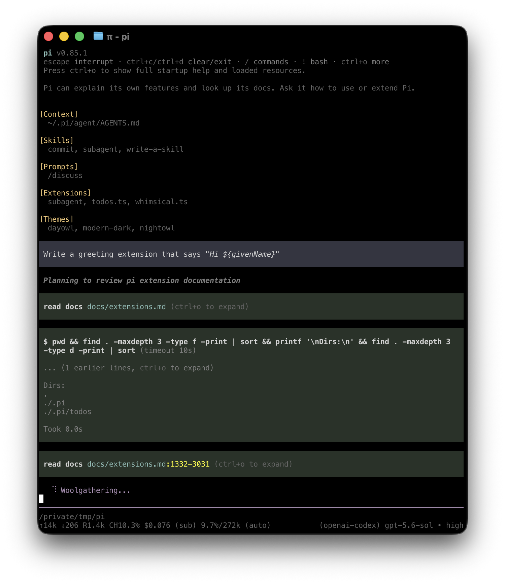

> 这是简体中文译本，译自 `packages/coding-agent/docs/quickstart.md`。与英文原文如有出入，以原文为准。

# 快速开始

Pi 在终端中运行，并操作你机器上的文件。要使用它，你需要通过受支持的 provider（提供商）访问模型。这可以是订阅、API 密钥或本地模型。

关于原生 Windows 的设置，请阅读 [Windows 安装](windows.md)。Android 请阅读 [Termux 安装](termux.md)。

## 1. 安装 Pi

在 macOS、Linux 或 Windows 上使用安装器安装 Pi：

```bash tab="macOS / Linux"
curl -fsSL https://pi.dev/install.sh | sh
```

```powershell tab="Windows"
powershell -c "irm https://pi.dev/install.ps1 | iex"
```

两个安装器都会锁定所有依赖，并通过 `pi update` 更新 Pi。也可以从 npm 安装 Pi，这种方式不会锁定传递依赖。这需要 Node.js 22.19 或更高版本：

```bash
npm install -g --ignore-scripts @earendil-works/pi-coding-agent
```

正常的 npm 安装不需要依赖生命周期脚本。

在 macOS 或 Linux 上使用 Nix 时，可以从 Pi 的 flake 安装最新版本。Nix 会从源码构建 Pi：

```bash
nix profile add github:earendil-works/pi/stable
```

较旧的 Nix 版本改用 `nix profile install`。使用 `nix profile upgrade pi` 更新；`pi update` 无法更新 Nix 安装。要固定某个版本，请使用诸如 `github:earendil-works/pi/v1.0.0` 的标签。

验证安装：

```bash
pi --version
```

## 2. 启动 Pi

切换到你想让 Pi 处理的文件夹，然后启动它：

```bash
cd /path/to/folder
pi
```

工作文件夹帮助 Pi 发现相关文件、指令和配置。Pi 还用它来归类已保存的会话。

<p align="center"></p>

界面显示你的对话、用于输入提示和命令的编辑器，以及显示当前文件夹、模型和会话状态的页脚。参见 [在终端中使用 Pi](usage.md)，了解如何添加文件、运行命令、引导进行中的工作以及管理结果。

## 3. 选择模型

**模型**生成 Pi 的回复。**provider** 是 Pi 用来访问该模型的服务或账户。

在 Pi 中运行：

```text
/login
```

选择一个 provider，然后按提示使用订阅或保存 API 密钥。如果之后想选择其他可用模型，请运行 `/model`。

关于受支持的 provider、通过环境变量认证、本地模型和自定义端点，参见 [选择模型和 provider](models.md)。

## 4. 给 Pi 一个任务

Pi 会显示它执行的每次文件读取、搜索、命令和编辑。它不会在每次工具调用前询问。

输入与你工作相符的任务，例如：

```text
Summarize @meeting-notes.md and save the action items to action-items.md.
```

```text
Explain how this repository is structured and how to run its checks.
```

```text
Compare @previous.csv with @current.csv and summarize the important changes.
```

在编辑器中输入 `@` 可以搜索文件，而不必输入完整路径。Pi 完成后，检查它的回复以及所有被改动的文件。重要工作请使用版本控制或备份。对于不可信或无人值守的工作，请使用容器或其他沙箱。参见 [安全](security.md)。

## 稍后继续

Pi 会自动保存会话。退出 Pi，然后用以下命令恢复同一工作文件夹最近的会话：

```bash
pi --continue
```

使用 `/resume` 选择另一个已保存的会话。关于会话命名、分支、压缩、导出和分享，参见 [继续或分支一个会话](sessions.md)。

## 后续步骤

- [交互式使用 Pi](usage.md)，了解输入、命令、快捷键和排队的消息。
- [添加指令](configuration.md#context-files)，让 Pi 在某个文件夹中工作时始终遵循。
- [选择模型和 provider](models.md)。

### 选择如何自定义 Pi

从满足你需要的最简单机制开始：

| 需求 | 从这里开始 |
|---|---|
| 为某个文件夹给 Pi 提供持久指令 | [`AGENTS.md`](configuration.md#context-files) |
| 在 `/` 菜单中复用提示 | [提示模板](prompt-templates.md) |
| 添加针对具体任务的指令和支持文件 | [技能](skills.md) |
| 添加可执行的工具、命令或事件处理器 | [扩展](../../../packages/coding-agent/docs/extensions.md) |
| 构建自定义终端组件 | [终端 UI](tui.md) |
| 连接不受支持的模型服务 | [自定义 provider](custom-provider.md) |
| 安装或分发多个资源 | [Pi 包](packages.md) |

## 卸载 Pi

如果你用 npm 安装了 Pi，请运行：

```bash
npm uninstall -g @earendil-works/pi-coding-agent
```

如果你使用了安装器，请再次运行它并选择 **Uninstall Pi**：

```bash
curl -fsSL https://pi.dev/install.sh | sh
```

如果你用 Nix 安装了 Pi，请运行：

```bash
nix profile remove pi
```

这些方法都不会从 `~/.pi/agent/` 中删除配置、凭证、会话或已安装的 Pi 包。
