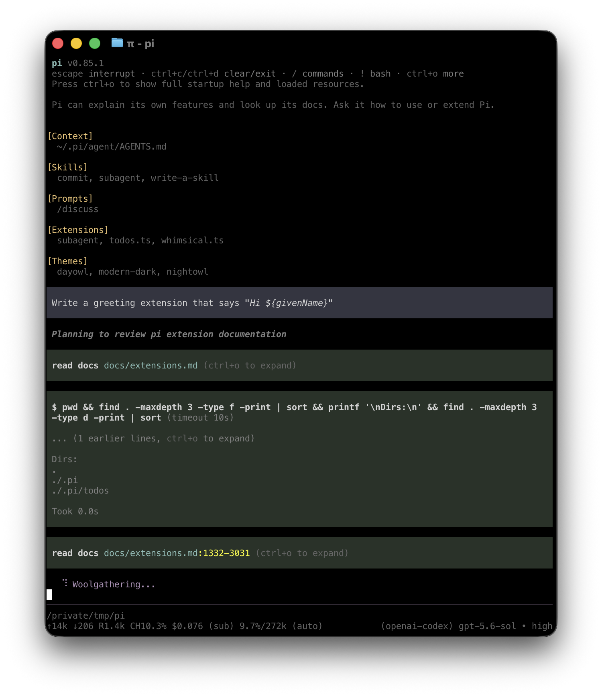

> 这是简体中文译本，译自 `packages/coding-agent/docs/usage.md`。与英文原文如有出入，以原文为准。

# 在终端中使用 Pi

在你想工作的文件夹中运行 `pi`。Pi 使用该文件夹发现文件、指令和配置，并归类已保存的会话。如果你还没有安装 Pi 或选择模型，请按照[快速开始](quickstart.md)操作。

在加载项目资源之前，Pi 可能会询问你是否信任该工作文件夹。参见[项目信任](security.md#understand-project-trust)。

<p align="center"></p>

对话记录显示你的提示、Pi 的回复、工具调用、结果和错误。你在编辑器中编写提示和命令。页脚显示当前文件夹、会话、模型、上下文用量以及累计用量和费用。

## 输入提示

输入请求并按 `Enter` 发送。使用 `Shift+Enter` 添加一行，或按 `Ctrl+G` 在已配置的外部编辑器中编辑较长的提示。

要包含文件或图像：

- 输入 `@` 搜索文件并将其添加到提示中。
- 按 `Tab` 补全路径。
- 粘贴图像，或将其拖入兼容的终端。

## 跟进 Pi 的工作

Pi 在工作时显示每次工具调用和结果。按 `Ctrl+O` 展开或折叠工具输出。按 `Ctrl+T` 显示或隐藏思考块。

启动头部列出 Pi 已加载的指令和资源。编辑器边框指示当前的思考级别。页脚随着模型使用上下文和报告用量而更新。

Pi 不会在每次工具调用前询问。请检查命令和被改动的文件，并为不可信或无人值守的工作使用沙箱。参见[安全](security.md)。

## 改变方向

Pi 工作时你仍可以发送更多输入：

| 你想要 | 操作 |
|---|---|
| 调整当前任务 | 输入消息并按 `Enter` |
| 在当前任务之后添加工作 | 输入消息并按 `Alt+Enter` |
| 把排队的消息返回到编辑器 | 按 `Alt+Up` |
| 停止当前任务 | 按 `Escape` |

用 `Enter` 发送的消息会等待当前回复及其工具调用完成，然后引导下一次回复。用 `Alt+Enter` 发送的后续消息会等到 Pi 完成当前任务。中止会把排队的消息返回到编辑器。

Windows Terminal 保留了部分 Alt 快捷键。关于 Windows 上的替代方案，参见[终端设置](terminal-setup.md)。

## 更改模型或设置

输入 `/` 搜索可用命令。你最常使用的命令是：

- `/model` 选择一个模型。按 `Ctrl+L` 打开同一个选择器。
- `/thinking` 选择当前模型使用的推理量。按 `Shift+Tab` 在受支持的级别之间循环。
- `/login` 和 `/logout` 管理 provider（提供商）的访问。
- `/settings` 更改常用偏好。

提示模板、技能和扩展可以向同一菜单添加更多命令。参见[选择模型](models.md)、[配置](configuration.md)，或完整的[斜杠命令参考](slash-commands.md)。

## 继续或重新开始

除非禁用了会话持久化，否则 Pi 会自动保存会话。

- `/new` 开始一个新会话。
- `/resume` 打开另一个已保存的会话。
- `/name` 给当前会话一个易识别的名称。
- `/session` 显示其文件、ID、消息数、token 用量和费用。

当你想探索另一种做法而不丢失现有工作时，使用 `/tree`、`/fork` 或 `/clone`。使用 `/compact` 减少发送给模型的对话历史。关于这些工作流，参见[会话和上下文](sessions.md)。

离开 Pi 后，在同一文件夹中运行 `pi --continue` 以恢复其最近的会话。

## 运行终端命令

在命令前加 `!` 来运行它，并把其输出包含到对话中：

```text
!git status
```

如果你希望运行命令但不把输出发送给模型，请使用 `!!`。

## 复制、导出或分享结果

按 `Ctrl+X` 或运行 `/copy` 复制最后一条助手回复。使用 `/export` 把会话保存为 HTML 或 JSONL。

使用 `/share` 上传会话并获得查看链接。默认情况下，Radius 认证会让该产物对你的 Radius 组织可见；否则，Pi 会通过 GitHub CLI 创建一个私有 GitHub gist。设置 [`sessionShareDestination`](settings.md#sessions-and-context) 可以强制指定任一目的地。请先检查会话，因为它可能包含对话期间暴露的提示、工具输出、文件内容和凭证。

## 调整终端

全屏模式是默认模式，它在对话记录于终端窗口内滚动时保持编辑器和状态区域固定。常规模式使用终端正常的回滚缓冲区。通过 `/settings` 或 `--tui-mode` 选择模式。

终端对鼠标输入、键盘快捷键和行内图像的支持各不相同。关于各平台的配置，参见[终端设置](terminal-setup.md)；关于所有可配置的快捷键，参见[快捷键](keybindings.md)。运行 `/hotkeys` 查看当前会话中生效的快捷键。

## 收集诊断信息

在排查终端渲染或对话状态问题时，运行 `/debug`。Pi 会把渲染后的终端行和当前会话消息写入 [agent 目录](configuration.md#agent-directory)中的 `pi-debug.log`。

分享此文件前请先检查。它可能包含提示、模型回复、工具输出、文件内容和终端数据。
